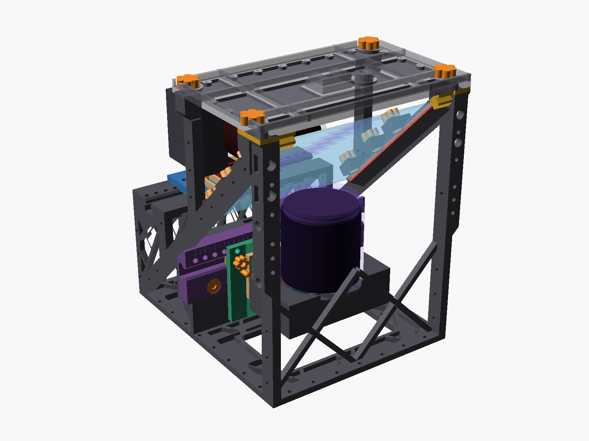
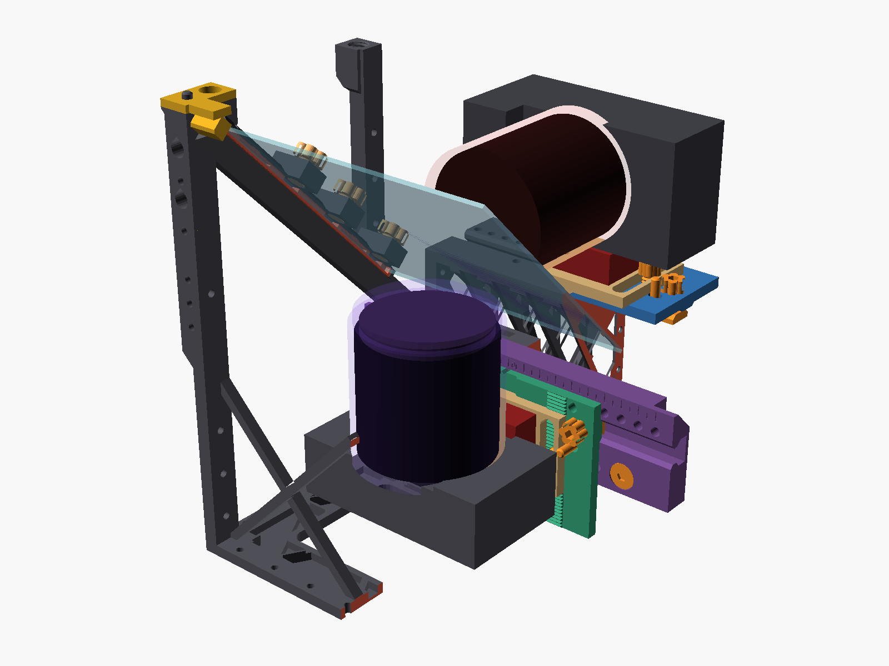
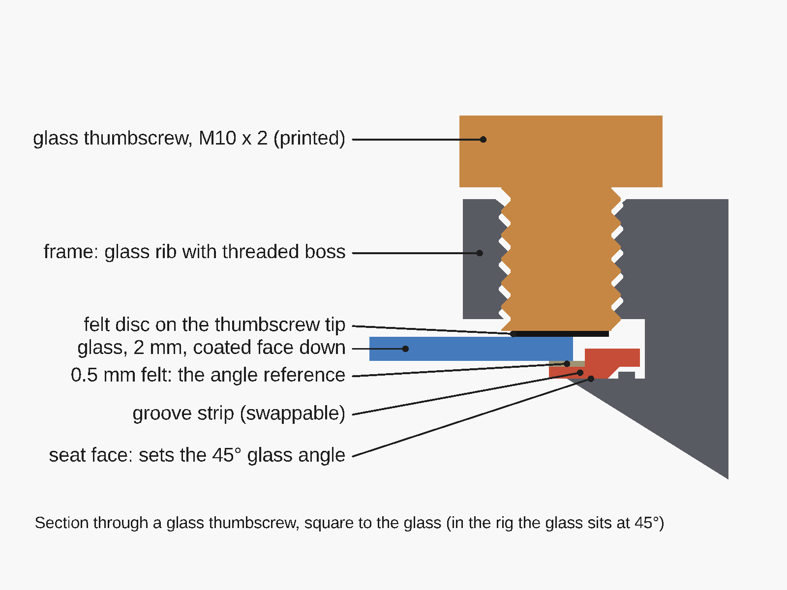
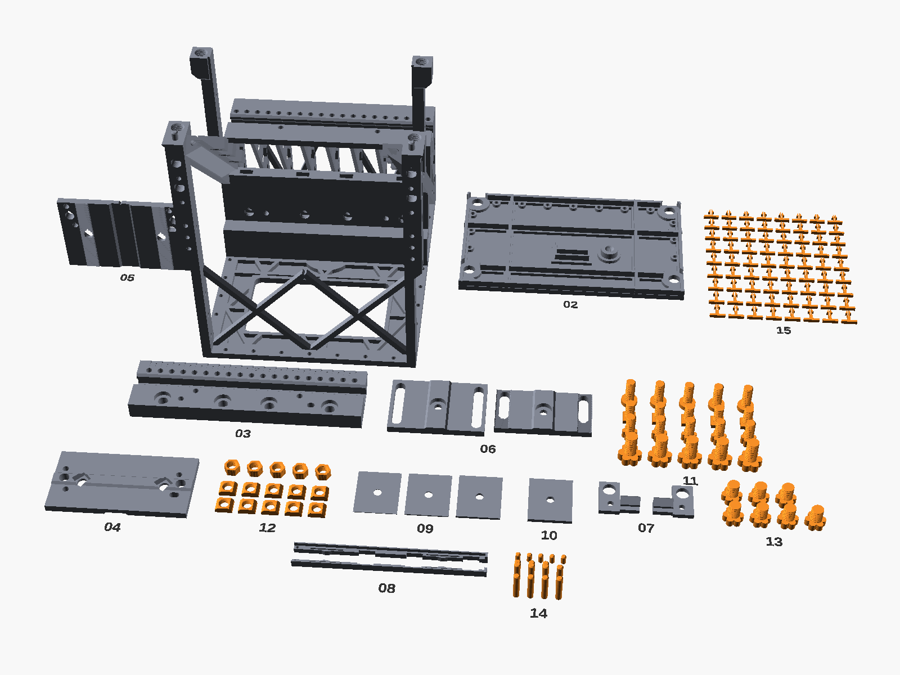

# BeamSplitter

A 3D-printable rig that holds a 150 × 150 mm plate beam splitter at a fixed 45° between two Sony mirrorless cameras.
Both cameras see the scene from the **same viewpoint**: one in visible light, one in infrared. Slide the cameras apart
and the same rig becomes a **small-interaxial stereo** rig.

> **Status: v1.0, built and shooting.** Every part has been printed and the rig has been used for real shoots with two
> Sony bodies (see the LinkedIn video). The numbers in this README are design values from the model, not measurements.
> Build and use it at your own risk, and read [Known limitations](docs/LIMITATIONS.md) first.

## What it is for

| Mode | How | Result |
|---|---|---|
| **Visible + infrared compositing** (main use) | The rear camera (default: Sony a6400 + Sony E 15 mm F1.4 G) looks straight through the glass. The bottom camera (default: full-spectrum Sony a5100 + Sony E 10–18 mm F4 at 18 mm with a 62 mm IR filter) looks up at the reflection. | Both entrance pupils sit at the same optical distance from the glass, so near and far objects line up in both images (no parallax). You can overlay the IR and visible frames in post. |
| **Stereo** | Both cameras slide sideways on rails in opposite directions, 0–85 mm apart, in 5 mm index steps. | Stereo pairs with an interaxial much smaller than two bodies side by side allow. |

## Features

- **One OpenSCAD file, fully parametric.** Enter your own camera, lens and quick-release measurements and re-export.
  No external libraries.
- **One-piece open-truss frame.** It is light and stiff, and its open sides give access to the camera controls and
  room for stereo travel. A window in the base shows the bottom camera's screen and gives access to its buttons.
- **Glass angle set by the frame.** The glass sits in two small keyed, spring-loaded **groove strips** that slide into
  the frame and stay there by themselves. The frame's seat face sets the 45° angle, not the strips. A different glass size or a damaged groove means reprinting
  only the strips (about 8 g).
- **Bolted lid.** It is the top chord of the frame, a light trap above the glass and a cold-shoe mount.
- **F38 quick release** on both cameras. Each camera rides a slide along its lens axis (for matching the viewpoints)
  on a sideways carriage (for stereo). Datum pins return both carriages to the compositing position.
- **Almost everything is printed.** That includes the thumbscrews, nuts, T-nuts, pins, wrap clips and threads. You only
  buy three 1/4"-20 screws, self-adhesive felt and (optionally) one heat-set insert.
- **Support-free.** Every STL is already in its print orientation, and no part needs supports.
- **Built-in checks.** The model checks clearances and fields of view with assertions and prints a summary. Python
  scripts audit printability and estimate the stereo crop.

## Repository map

| Path | Contents |
|---|---|
| [`model/beamsplitter_rig.scad`](model/beamsplitter_rig.scad) | The whole design. This is the single source of truth. |
| [`stl/`](stl/) | Ready-to-print STLs exported from the model with its default values |
| `stl/tests/` | Test coupons (print these first) |
| `stl/alternatives/` | Other tripod-mount versions of the frame |
| [`docs/`](docs/) | Printing, assembly, customizing, design notes, parts list, limitations |
| [`tools/`](tools/) | Python check scripts (printability, stereo crop, centre of gravity) |
| [`AGENTS.md`](AGENTS.md) | Notes for contributors |

## Quick start A: "I just want to print it"

You need an FDM printer with a build volume of at least **250 × 250 × 245 mm** (the frame is 208 × 235 × 244 mm). The
design assumes a 0.4 mm nozzle. PLA is fine for a prototype; PETG is recommended
for the final build. Expect about **1.3 kg of filament** including the test coupons (two 1 kg spools).

> The STLs are built for the default cameras, lenses and an Ulanzi UKA01-type F38 kit. Some of the defaults are
> estimates, most importantly the entrance-pupil positions of the two lenses. Small errors are taken up by the shims and
> slides. If your gear differs, or you want a calibrated final build, use quick start B.

1. **Print the test coupons** in `stl/tests/` and check them as described in [PRINTING.md](docs/PRINTING.md#test-coupons).
   They tell you whether the printed threads and pins fit on your printer. If they don't, change one number and
   re-export (quick start B).
2. **Print the numbered files.** Use the settings in [PRINTING.md](docs/PRINTING.md): supports off, no rotating, no
   auto-orient. Files marked *solid* are hardware and need 100 % infill.

   

   | # | File | Print | What it is |
   |---|---|---|---|
   | 01 | `01_frame.stl` | 1× | One-piece frame (≈ 0.7 kg, the long print). Has a hole for a 1/4"-20 heat-set insert as the tripod socket. For other options, see below. |
   | 02 | `02_top_lid.stl` | 1× | Lid: top chord, light trap, cold shoe |
   | 03 | `03_wall_rail.stl` | 1× | Sideways rail for the bottom camera |
   | 04 | `04_rear_carriage.stl` | 1× | Rear camera carriage |
   | 05 | `05_bottom_carriage.stl` | 1× | Bottom camera carriage |
   | 06 | `06_f38_slides_x2.stl` | 1× (gives 2) | Fore-aft slides that carry the F38 bases |
   | 07 | `07_glass_stops_x2.stl` | 1× (gives 2) | Stops that keep the glass from sliding out |
   | 08 | `08_groove_strips_x2.stl` | 1× (gives 2) | Glass groove strips, printed on their side as laid out and solid. Keep both in one print so they come out the same thickness. |
   | 09 | `09_shim_set_print_2x.stl` | **2×** | 0.5 / 1 / 2 mm shims, one set per camera |
   | 10 | `10_swap_shim_3mm_riser.stl` | 1× | 3 mm riser. **Required** for the default a5100 (it goes between the body and its F38 plate). |
   | 11 | `11_hardware_screws_solid.stl` | 1× | Lid thumbscrews, clamp thumbscrews, T-bolts, rail bolts (with spares) |
   | 12 | `12_hardware_nuts_solid.stl` | 1× | T-nuts and thumb-nuts (with spares) |
   | 13 | `13_glass_thumbscrews_solid.stl` | 1× | Seven M10 thumbscrews that hold the glass (6 + 1 spare) |
   | 14 | `14_pins_solid.stl` | 1× | Datum, alignment and F38 locating pins (with spares) |
   | 15 | `15_wrap_clips.stl` | optional | 72 push-through clips for the black side wrap (tape or zip ties work too) |

   **Tripod socket: choose before printing the frame.**

   | Option | Files | Buy |
   |---|---|---|
   | Heat-set insert (default, strongest 1/4" socket) | `01_frame.stl` | one 1/4"-20 × 8 mm heat-set insert |
   | Printed 1/4"-20 thread | `stl/alternatives/frame_tripod_printed.stl` instead of `01_frame.stl` | nothing. Tighten the tripod screw gently. |
   | Arca-Swiss plate | `stl/alternatives/frame_tripod_arca.stl` instead of `01_frame.stl`, plus `stl/alternatives/arca_plate.stl` | nothing. Needs an Arca-type clamp on your tripod. |

3. **Get the few bought parts** (see the next section).
4. **Assemble** following the illustrated [assembly guide](docs/ASSEMBLY.md): 29 steps with a picture each, from
   checking the parts to the first alignment.

## Quick start B: "I want to adapt it to my cameras"

1. Install [OpenSCAD](https://openscad.org/) (developed with version 2021.01; no libraries needed).
2. Open `model/beamsplitter_rig.scad`, press **F5** and open **Window → Customizer**.
3. Measure your gear and fill in the **Measure first** group: entrance pupils, IR filter, camera axis heights, F38
   stack and footprint. [CUSTOMIZE.md](docs/CUSTOMIZE.md) explains each measurement, including a 10-minute method
   for finding a lens's entrance pupil.
4. Press **F5** again and read the console. A summary is printed first. If a value does not work, a red
   `ERROR: Assertion ... failed` message names the problem and the fix.
5. Export the parts you need. In the Customizer, set `part`, press **F6**, then use **File → Export → STL**. You can
   also export from the command line (see [CUSTOMIZE.md](docs/CUSTOMIZE.md#exporting-stls)).

## What you need to buy

| Item | Qty | Notes |
|---|---|---|
| 150 × 150 × 2 mm plate beam splitter, 50R/50T | 1 | Other sizes from 149.6–154 × 145–150.8 mm work with reprinted strips. An anti-reflection coated back reduces ghosting. |
| F38 quick-release kit (base + plate), e.g. Ulanzi UKA01 | 2 | |
| 1/4"-20 × 3/8" low-head steel screw (head ≤ Ø13 × 4 mm) | 2 | Fixes each F38 base to its slide |
| 1/4"-20 screw, 3 mm longer than your F38 plate screw | 1 | For the a5100 plus the 3 mm riser |
| Self-adhesive felt, 0.5 mm | ≈ 0.1 m² | Lines everything that touches the glass. Bare plastic must never touch the coating. |
| 1/4"-20 × 8 mm heat-set insert | 1 | Only for the default frame's tripod socket |
| Black aluminium foil (e.g. Cinefoil) or IR-tested blackout fabric, flocking film | ≈ 1 m², ≈ 0.03 m² | Side wrap and lid lining. Black plastic and many black fabrics are **not** black in infrared. |

Tools: a soldering iron (for the insert), calipers, a 5 mm hex key and a knife. You don't need a reamer, glue or a
wrench. The full list is in [HARDWARE.md](docs/HARDWARE.md).

## Documentation

| Document | Read it when |
|---|---|
| [docs/PRINTING.md](docs/PRINTING.md) | Slicing and printing, and what the test coupons tell you |
| [docs/ASSEMBLY.md](docs/ASSEMBLY.md) | Illustrated step-by-step assembly, first alignment, stereo, service and troubleshooting |
| [docs/CAMERAS.md](docs/CAMERAS.md) | Supported cameras and lenses, key distances, and how to scale the rig |
| [docs/CUSTOMIZE.md](docs/CUSTOMIZE.md) | Changing cameras, lenses, glass size or fits in OpenSCAD |
| [docs/DESIGN.md](docs/DESIGN.md) | How the optics and the structure work, and how to run the checks |
| [docs/HARDWARE.md](docs/HARDWARE.md) | Complete bought and printed parts list |
| [docs/LIMITATIONS.md](docs/LIMITATIONS.md) | What is not proven yet and known trade-offs |
| [CHANGELOG.md](CHANGELOG.md) | Release notes |

## Safety

- **Glass.** The plate's edges are sharp and the plate can crack. Wear gloves and hold it by the edges. Never carry or
  tilt the rig with the lid off and the glass in: the glass stops are only held in place by the lid.
- **Coating.** Only felt may touch the glass. Keep fingers off the coated face.
- **Structure.** The lid is part of the frame's structure. Don't mount the rig on a tripod or handles without it.
- **Printed threads.** Tighten by hand only. A long lever strips printed threads. The loaded rig weighs about 2.4 kg.
- **Heat-set insert.** The soldering iron is hot enough to burn you and to soften the frame around the hole. Go
  slowly.

## License

The hardware design (OpenSCAD model, STLs, images and documentation) is licensed under the
[CERN Open Hardware Licence v2 – Strongly Reciprocal](LICENSE-HARDWARE) (CERN-OHL-S-2.0). The scripts in `tools/`
are licensed under the [MIT License](LICENSE). Both are provided as is, without warranty of any kind; you build and
use the rig at your own risk.

## Contributing

Build reports, photos, measurements of other cameras and lenses, and fixes are welcome. See
[CONTRIBUTING.md](CONTRIBUTING.md).
