# Assembly guide

This guide takes you from a pile of printed parts to a working, aligned rig in 29 illustrated steps. It assumes the
default build: printed hardware, the heat-set tripod insert, a Sony a6400 as the rear camera and a full-spectrum
a5100 as the bottom camera. Each step has one picture with the same number.

**Time needed** (a rough estimate for a first build; printing time not included):

| Stage | Steps | Time |
|---|---|---|
| Check the parts, clean up, paint and flock | 1–5 | about 1.5 h, plus time for the paint to dry |
| Tripod insert, wall rail, carriages and slides | 6–14 | about 1.5 h |
| Groove strips, felt, glass, stops and lid | 15–22 | about 1.5 h |
| Cameras and first alignment | 23–26 | 1–2 h |
| Side wrap | 27 | about 30 min |

That is about 6–7 hours, best split over two sessions so the paint can dry before any glass is near.

**How to read the step pictures**

- **Dark grey** is the frame. **Light grey** is parts you fitted in earlier steps.
- **Orange** is the part you fit in this step. **Blue** is a second new part in the same step.
- **Red arrows** show which way to move a part. Curved red arrows mean "turn".
- **Green** is felt (real felt is usually black). **Pale blue** is the glass, and **yellow** marks its coated face.
- **Dark red** boxes are the bought F38 quick-release parts. The cameras are simple block shapes.

**Words used in this guide**

| Word | Meaning |
|---|---|
| Front | The scene side, where the rig points. **Rear** is where the rear camera sits. |
| +X side | Your **left** when you stand behind the rig facing the scene. −X is your right. |
| Rib | Each of the two diagonal members of the frame that carry the glass |
| Channel | The slot along each rib that a groove strip slides into |
| Boss | A threaded block on a rib that holds a glass thumbscrew (three per rib) |
| Crosswall | The wall behind the bottom camera |
| Deck | The raised platform at the rear that carries the rear camera |
| Datum pins | The pins that lock both carriages at the zero (compositing) position |

Part numbers like `08_groove_strips_x2` are the file names in [`stl/`](../stl/). Names like `ps_clear` are OpenSCAD
parameters (see [CUSTOMIZE.md](CUSTOMIZE.md)).

## Contents

1. [What you need](#1-what-you-need) (steps 1–2)
2. [Safety](#2-safety)
3. [Prepare the prints](#3-prepare-the-prints) (steps 3–5)
4. [Tripod socket](#4-tripod-socket) (step 6)
5. [Wall rail](#5-wall-rail) (steps 7–8)
6. [Carriages](#6-carriages) (steps 9–11)
7. [Slides and F38 bases](#7-slides-and-f38-bases) (steps 12–14)
8. [Groove strips](#8-groove-strips) (steps 15–18)
9. [Glass](#9-glass) (steps 19–20)
10. [Close the top](#10-close-the-top) (steps 21–22)
11. [Cameras](#11-cameras) (steps 23–24)
12. [First alignment](#12-first-alignment) (steps 25–26)
13. [Light-proofing](#13-light-proofing) (step 27)
14. [Stereo](#14-stereo) (step 28)
15. [Service](#15-service) (step 29)
16. [Using the rig](#16-using-the-rig)
17. [Troubleshooting](#17-troubleshooting)

## 1. What you need

### Step 1. Printed parts

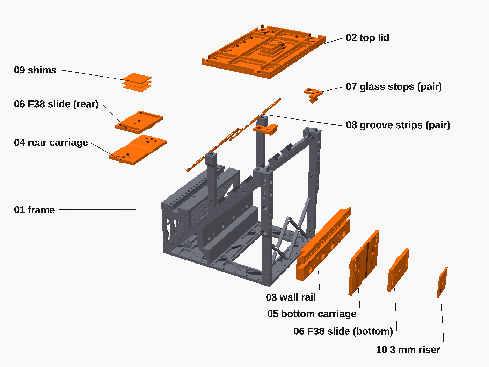

Check that you have every printed part. Tick them off.

| File | Qty | What it is |
|---|---|---|
| `01_frame.stl` | 1 | One-piece frame. For the other tripod options, use `stl/alternatives/frame_tripod_printed.stl`, or `frame_tripod_arca.stl` together with `arca_plate.stl`, instead. |
| `02_top_lid.stl` | 1 | Lid: top of the frame, light trap and cold shoe |
| `03_wall_rail.stl` | 1 | Sideways rail for the bottom camera |
| `04_rear_carriage.stl` | 1 | Rear camera carriage |
| `05_bottom_carriage.stl` | 1 | Bottom camera carriage |
| `06_f38_slides_x2.stl` | 1 print = 2 slides | The **rear** slide has 40 mm slots. The **bottom** slide has teeth on its underside. |
| `07_glass_stops_x2.stl` | 1 print = 2 stops | A mirror pair, one per side |
| `08_groove_strips_x2.stl` | 1 print = 2 strips | A mirror pair, printed together and solid |
| `09_shim_set_print_2x.stl` | **2 prints** | Two sets of 0.5, 1 and 2 mm shims, one set per camera |
| `10_swap_shim_3mm_riser.stl` | 1 | 3 mm riser for the a5100 |

> **Warning: groove strips.** Both strips must come from the **same print**, so their lips have the same thickness.

### Step 2. Printed hardware, bought parts and tools

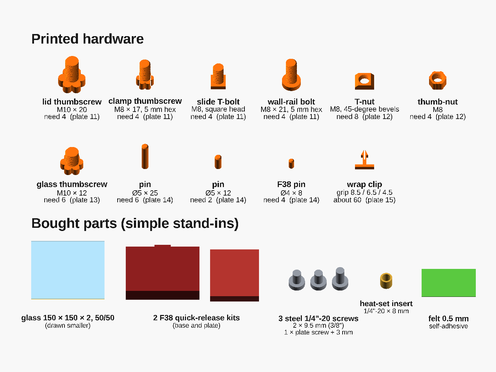

Lay out the printed hardware and count it. Each plate has about 20 % spares.

| Item | Size | Needed | From plate |
|---|---|---|---|
| Lid thumbscrew | M10 × 20 | 4 | `11_hardware_screws_solid` |
| Clamp thumbscrew | M8 × 17, 5 mm hex socket | 4 | `11_hardware_screws_solid` |
| Slide T-bolt | M8, square head | 4 | `11_hardware_screws_solid` |
| Wall-rail bolt | M8 × 21, round head, 5 mm hex socket | 4 | `11_hardware_screws_solid` |
| T-nut | M8, 45° bevels | 8 | `12_hardware_nuts_solid` |
| Thumb-nut | M8 | 4 | `12_hardware_nuts_solid` |
| Glass thumbscrew | M10 × 12 | 6 | `13_glass_thumbscrews_solid` |
| Pin | Ø5 × 25 | 6 | `14_pins_solid` |
| Pin | Ø5 × 12 | 2 | `14_pins_solid` |
| F38 pin | Ø4 × 8 | 4 | `14_pins_solid` |
| Wrap clip | grips of 8.5, 6.5 and 4.5 mm | about 60 | `15_wrap_clips` |

**Bought parts**

| Item | Qty |
|---|---|
| Beam-splitter glass, 150 × 150 × 2 mm, 50/50 | 1 |
| F38 quick-release kit (base and plate) | 2 |
| Steel 1/4"-20 × 3/8" (9.5 mm) screw with a low head (at most Ø13 × 4 mm) | 2 |
| Steel 1/4"-20 screw, 3 mm longer than your F38 plate's own screw | 1 |
| Self-adhesive felt, 0.5 mm | about 0.1 m² |
| Heat-set insert, 1/4"-20 × 8 mm (only for `01_frame.stl`) | 1 |

**For clean images**

| Item | Amount |
|---|---|
| Black aluminium foil (Cinefoil) or IR-tested blackout fabric | about 1 m² |
| Flocking film | about 0.03 m² |
| Matt black paint | a little |
| Black tape | a little |

**Tools**

| Tool | Used in |
|---|---|
| 5 mm hex key. A long one (140 mm or more) also reaches the bottom clamps from the front. | steps 8, 11, 28 |
| Soldering iron (only for the heat-set insert) | step 6 |
| Knife or deburring tool | step 3 |
| Scissors, a steel ruler, and an **8 mm** hole punch for the felt discs | steps 15, 18, 20 |
| Screwdriver or key for the 1/4"-20 screws | steps 12, 23 |
| Small pliers (to remove wrap clips) | step 27 |
| Gloves | steps 19, 29 |
| A pen, a pencil and tape | steps 13, 19, 23 |
| A paper clip, bent into a small hook | step 29 |
| Optional: calipers, and a digital angle gauge to check `groove_test` | — |

## 2. Safety

Follow these rules for the whole build:

- **Glass edges are sharp, and the plate can crack.** Wear gloves whenever you handle the glass, and hold it by its
  edges.
- **Only felt may touch the glass.** Never touch the coated face, and never let bare plastic touch it.
- **Tighten by hand only.** Turn thumbscrews finger-tight. Use only the **short** arm of the hex key on the hex-socket
  bolts. The working loads are small (a camera weighs about 5 N, and a hard bump is about 30 N), and a long lever
  strips a printed thread.
- **The lid is part of the structure.** Never carry or tilt the rig with the lid off and the glass in: without the
  lid, the glass stops only rest on their pins. Never load the rig (tripod, handles) with the lid off.
- **The soldering iron** is hot enough to burn you and to soften the frame around the hole. Go slowly.

## 3. Prepare the prints

### Step 3. Clean up the prints

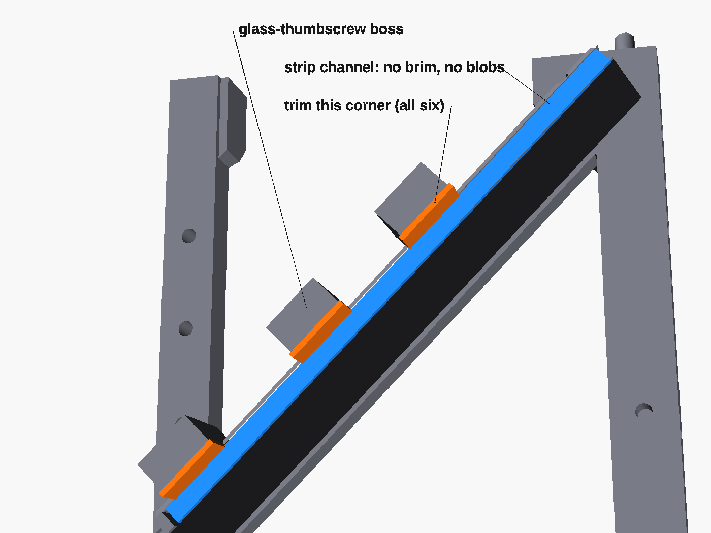

1. Remove every brim and any elephant's foot. Take most care with both groove strips and with the two strip channels
   in the frame's diagonal ribs.
2. Look under each of the six glass-thumbscrew bosses, three per rib. If the lower inner corner drooped, trim it with
   a knife so nothing hangs into the groove.
3. Keep the two groove strips together. They are a matched pair.

**Check:** each strip lies flat on a flat table without rocking.

> **Warning:** never print the frame with supports to avoid the drooping corners. The supports would land on the
> glass seat. The slicer's warning there is expected (see
> [PRINTING.md](PRINTING.md#slicer-warnings-you-can-ignore)).

### Step 4. Paint and flock

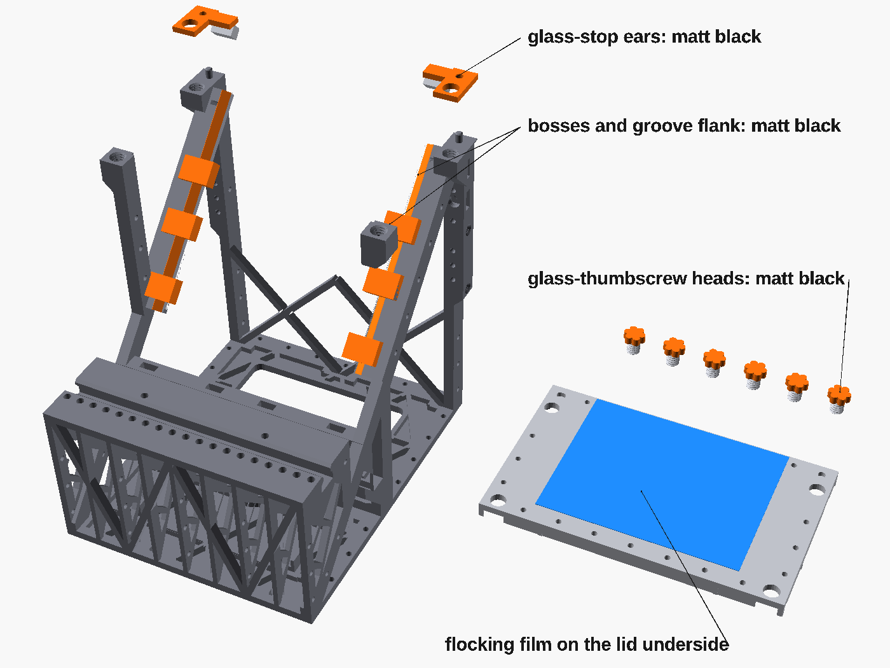

Do this now, before any glass is near.

1. Paint matt black: the six glass-thumbscrew bosses, the bevelled upper groove flank above each channel, the heads
   of the six glass thumbscrews, and the ears of the two glass stops.
2. Let the paint dry.
3. Stick flocking film over the flat underside of the lid. It is the light trap above the glass.
4. Cover any unused holes in the lid with black tape on the underside.

> **Warning:** keep paint out of the threads and off the channel's flat seat face, where the strip lies. That face sets
> the glass angle.

Black PLA and many black fabrics let infrared through. You test your materials with the full-spectrum camera in
step 27.

### Step 5. Chase the threads and test the pins

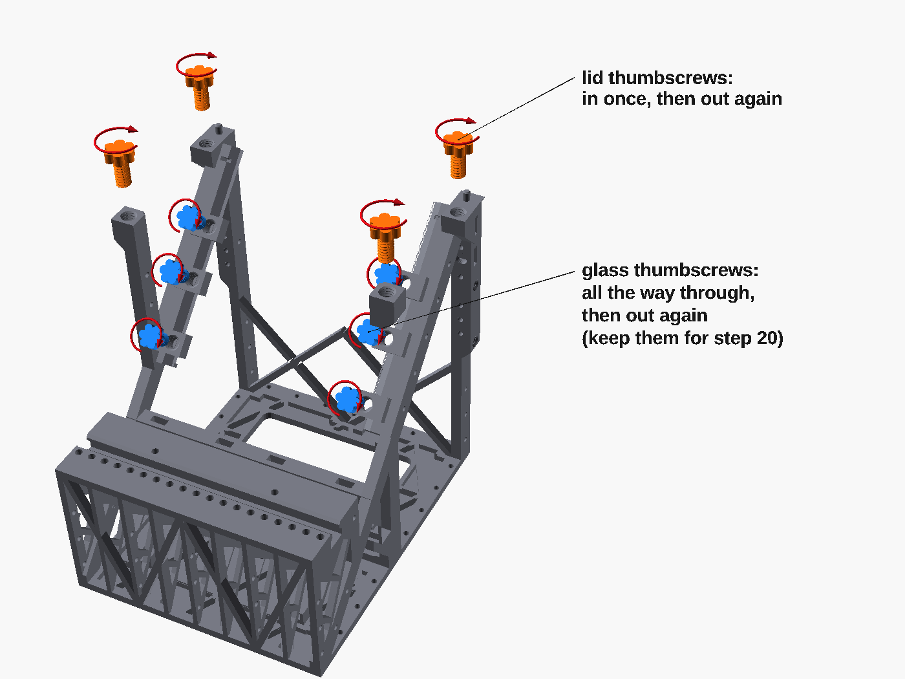

1. Turn the four lid thumbscrews into the threaded pads on the four post tops once, by hand, then take them out
   again.
2. Turn the six glass thumbscrews all the way through their bosses, then take them out again. Keep them for step 20.
3. Run each T-nut and thumb-nut onto an M8 screw once.
4. Push a Ø5 × 25 pin through a carriage pin hole into a rail hole. It must slide in by hand.
5. Try the Ø5 × 12 pins in the crosswall band and the F38 pins in the slides. They need a firm push. You press them
   in for good in steps 7 and 12.

> **Warning:** never force a thread. If one binds, check `thread_test` and `ps_clear` first (see
> [Troubleshooting](#17-troubleshooting)).

## 4. Tripod socket

### Step 6. Fit the tripod insert

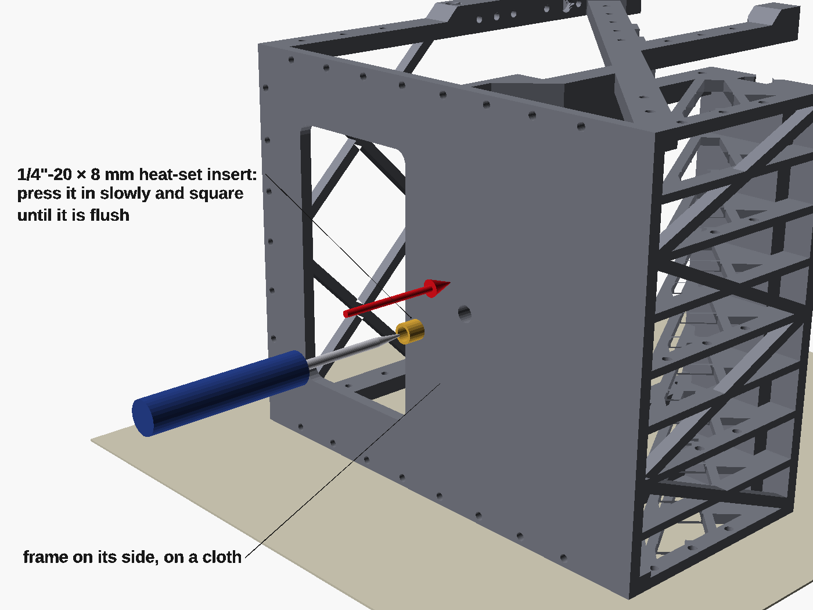

Do this on the bare frame. What you do depends on which frame you printed.

**`01_frame.stl` (heat-set insert):**

1. Lay the frame on its side on a cloth. Don't stand it upside down: it would rest on the two lid pins.
2. Set the 1/4"-20 × 8 mm heat-set insert on the hole in the underside of the base, at the foot of the crosswall.
3. Press it in slowly and square with the soldering iron, until it is flush.
4. Let it cool before you use it.

**Check:** the insert is flush and straight. A tripod screw turns in smoothly.

**`frame_tripod_printed.stl`:** run your tripod screw into the printed thread once, by hand. In use, turn the plate
screw in until it touches, then only a quarter turn more.

**`frame_tripod_arca.stl`:** fix the printed Arca plate with its two M10 thumbscrews, finger-tight.

## 5. Wall rail

### Step 7. Pins and T-nuts in the crosswall

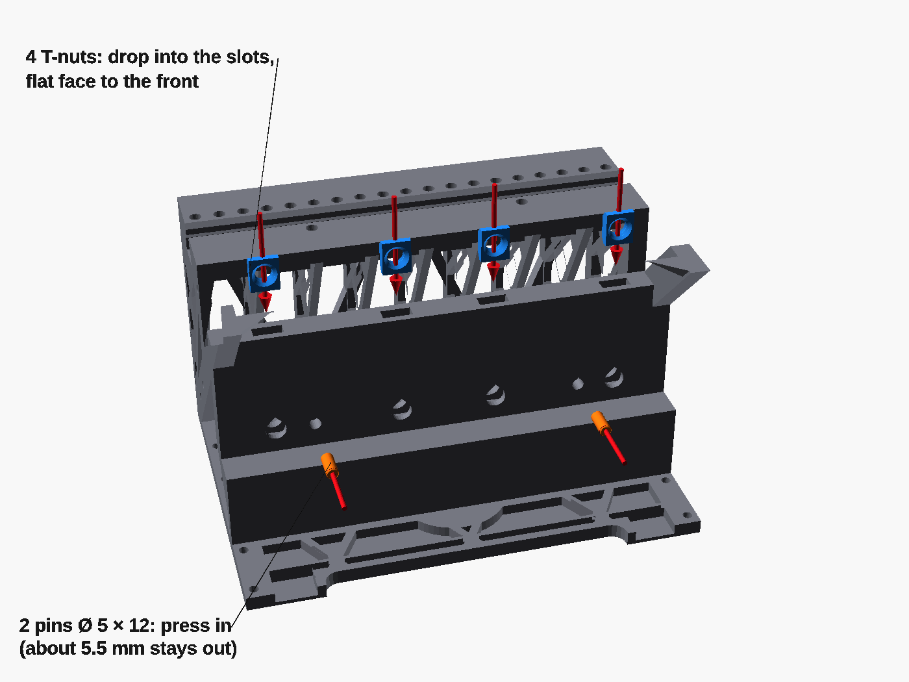

The crosswall is the wall behind the bottom camera.

1. Press the two short pins (Ø5 × 12) into the two small holes in its front band. They are in the same row as the
   four bolt holes, one on each side between the outer and the inner bolt hole. About 5.5 mm stays out.
2. Drop four T-nuts into the four slots in the top edge of the band, **flat face toward the front** (toward the rail).

**Check:** each T-nut sits on the slot floor with its hole in line with the bolt hole.

### Step 8. Bolt on the wall rail

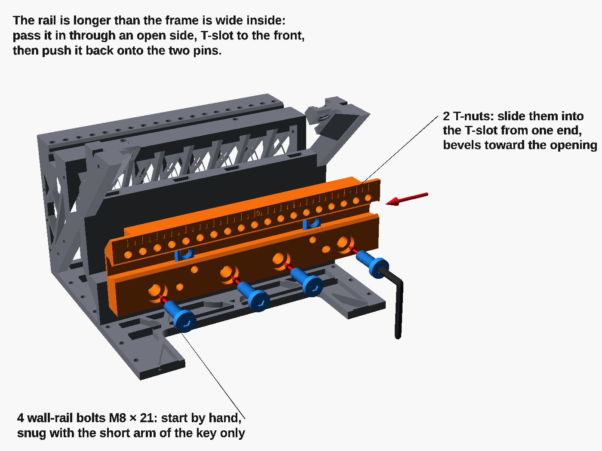

1. Slide two T-nuts into the wall rail's T-slot from one end, **bevels toward the slot opening**. Push them to about
   48 mm either side of the centre mark.
2. The rail is longer than the frame is wide inside, so pass it in through an open side of the frame, T-slot facing
   the front.
3. Push the rail back onto the two pins: the round hole goes on one pin, the slotted hole on the other.
4. Turn the four wall-rail bolts (M8 × 21, round head) through the rail into the T-nuts in the band. Start each one
   by hand.
5. Snug them with the **short arm** of the 5 mm key only.

> **Warning:** the long arm of the key gives enough leverage to strip a printed thread.

## 6. Carriages

### Step 9. T-bolts into the carriages

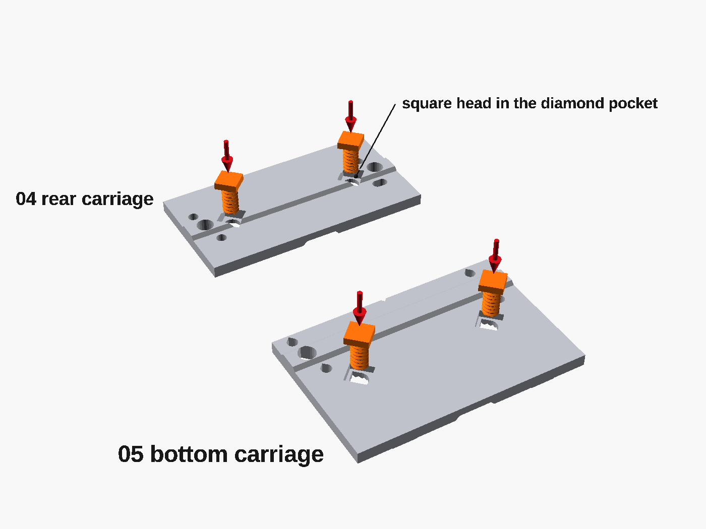

1. Lay both carriages rail face up: `04_rear_carriage` and `05_bottom_carriage`.
2. Drop two slide T-bolts into each one, shank first, so each square head sits in its diamond-shaped pocket.

**Check:** the square heads sit flat in their pockets.

> **Tip:** keep a finger on the bolts whenever you turn a carriage over in the next steps. Once the carriage is on its
> rail, the rail holds them in.

### Step 10. Fit the rear carriage

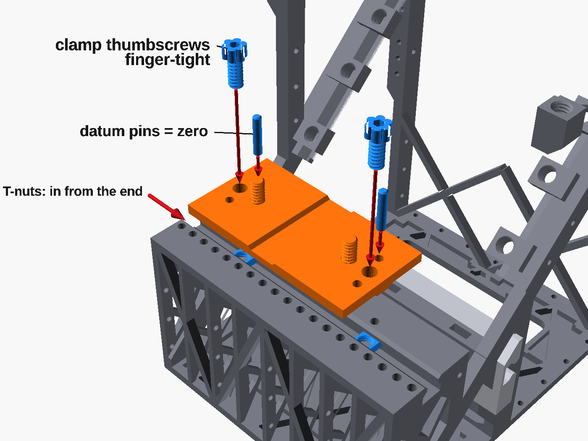

1. Slide two T-nuts into the T-slot on top of the rear deck from one end, **bevels up** toward the slot opening.
   Push them to about 48 mm either side of the centre.
2. Turn the rear carriage over, keeping the T-bolts in. Set it on the deck with its tongue in the rail's groove,
   centred.
3. Push the two datum pins (Ø5 × 25) through the carriage into the rail. This is the zero position.
4. Turn the two clamp thumbscrews (M8 × 17) down through the carriage into the T-nuts, finger-tight.

**Check:** with the pins in and the clamps snug, the carriage does not move.

### Step 11. Fit the bottom carriage

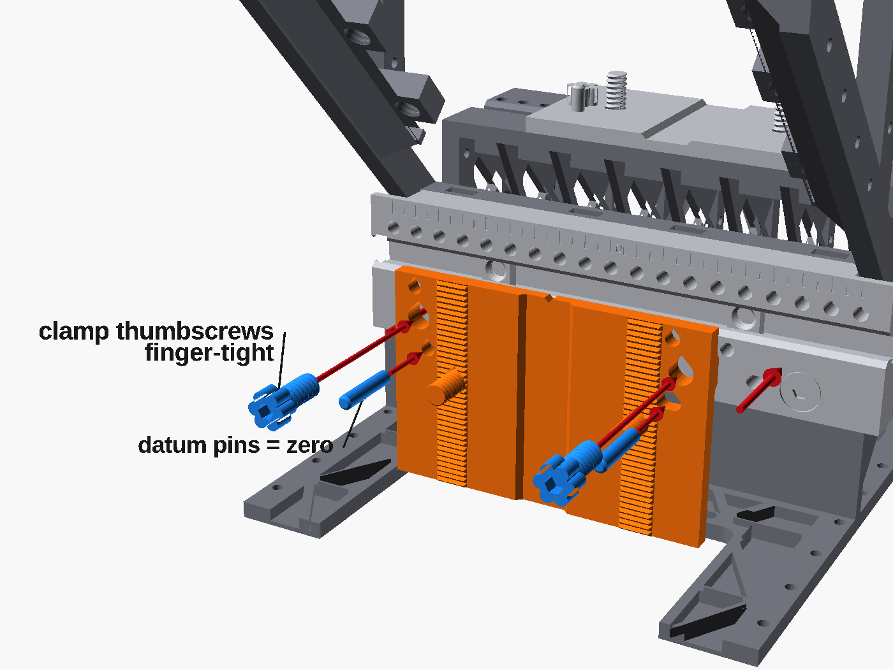

1. Hold the bottom carriage with a finger over its two T-bolts. Set it on the wall rail's front face, tongue in the
   groove, centred.
2. Push the two datum pins (Ø5 × 25) through the carriage's lower pin holes into the rail. This is the zero position.
3. Turn the two clamp thumbscrews (M8 × 17) through the carriage into the T-nuts, finger-tight.

> **Tip:** reach in by hand through an open side, or come from the front through the window in the front X-brace
> with a long 5 mm key.

## 7. Slides and F38 bases

### Step 12. F38 bases onto the slides

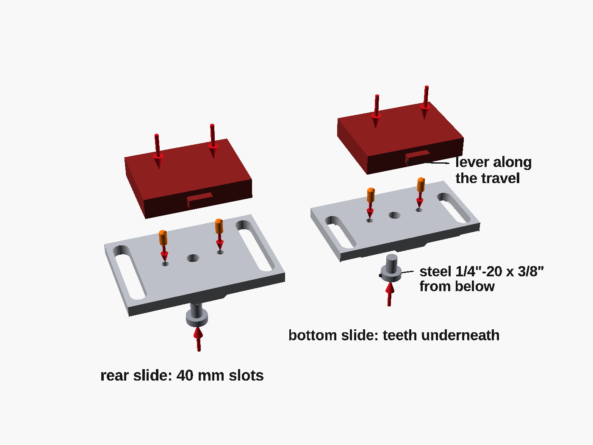

Do both slides on the bench. The rear slide has the 40 mm slots. The bottom slide has teeth on its underside.

1. Press two F38 pins (Ø4 × 8) into the two small holes in the top face of each slide. About 3 mm stays out.
2. Set an F38 base on each slide over its pins. If your base allows it, point the release lever along the slide's
   travel.
3. Fix each base from below with a steel 1/4"-20 × 3/8" screw. Its head sits in the counterbore inside the guide
   tongue.
4. Tighten it firmly by hand with a screwdriver or key.

This screw goes into the metal thread of the F38 base and carries the camera, so it must be steel.

### Step 13. Rear slide onto its carriage

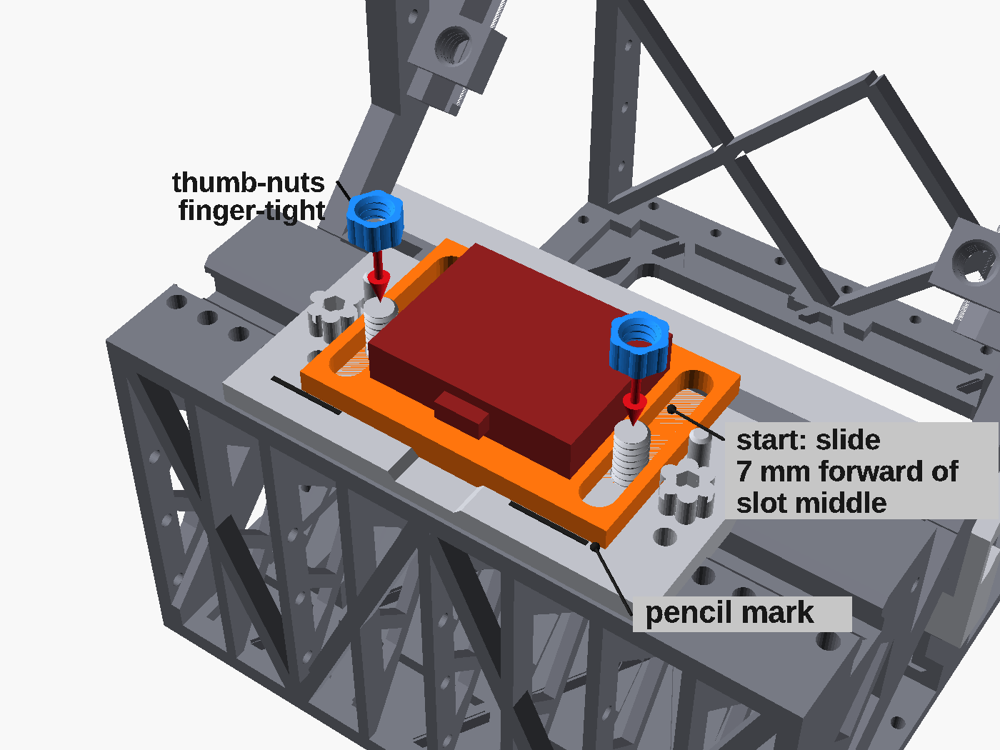

1. Lower the rear slide, F38 base up, onto the rear carriage: tongue in the carriage's groove, the two T-bolts up
   through its slots.
2. Set it about 7 mm forward of the middle of its slots. This is the starting position.
3. Spin a thumb-nut onto each T-bolt, finger-tight.
4. Mark the starting position on the carriage with a pencil.

> **Warning:** the rear lens touches the glass if this slide goes about 8 mm further forward than the mark.

### Step 14. Bottom slide onto its carriage

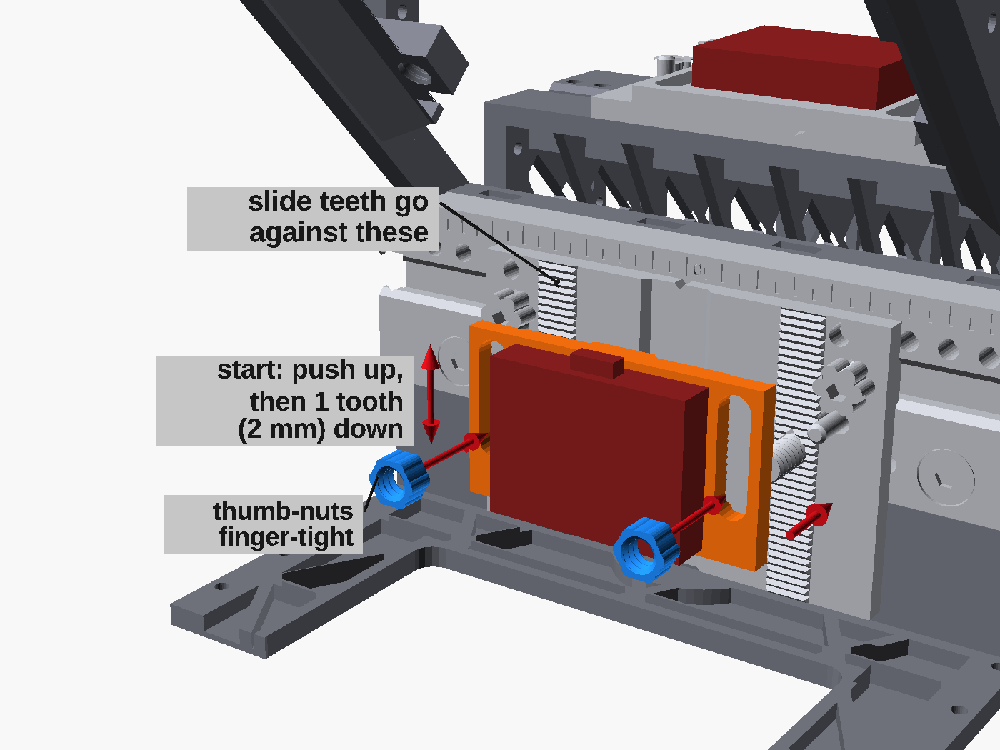

1. Put the bottom slide on the bottom carriage, F38 base facing the front: teeth against the carriage's teeth, tongue
   in the groove, T-bolts through the slots.
2. Push it up as far as it goes with the teeth meshed, then move it down by one tooth (2 mm). This is the starting
   position.
3. Spin on the two thumb-nuts, finger-tight.

**Check:** the teeth are fully meshed. The teeth carry the camera's weight, not the thumb-nuts.

## 8. Groove strips

The glass sits in two printed groove strips that slide into the channels in the frame's ribs. The frame's flat seat
face sets the 45° angle; the strips carry the felt and the end stop. Each strip **holds itself in** with two printed
springs, so it needs no bolts. Under each glass thumbscrew the strip has a low notch, so the thumbscrews press **only
on the glass**, never on the strip.

### Step 15. Felt on the groove strips

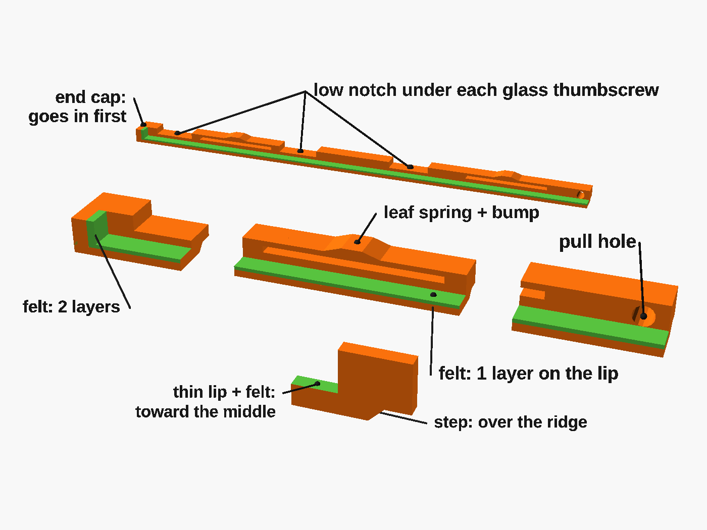

First get to know the strip. It has:

- a **thin lip** that goes toward the middle of the rig. The glass rests on it.
- a thicker **spine** with two printed **leaf springs**, each with a small bump on top. The bumps press on the channel
  roof and hold the strip in.
- three **low notches**, which sit under the glass thumbscrews.
- an **end cap** at one end, which goes in first.
- a small **pull hole** at the other end, for taking the strip out.
- a **step** underneath, which sits over a ridge in the channel.

Then:

1. Stick one layer of 0.5 mm felt on top of each strip's lip, about 3 × 152 mm, from the pull-hole end to the end cap.
2. Stick two layers (1 mm) on the inner face of each end cap, where the lower edge of the glass will rest.

**Check:** the lip felt is flat, with no wrinkles or overlaps. This face sets the glass angle.

> **Warning:** keep felt off the spring bumps and off the underside of the strip. The underside must lie flat on the
> frame's seat.

### Step 16. Slide the strips in

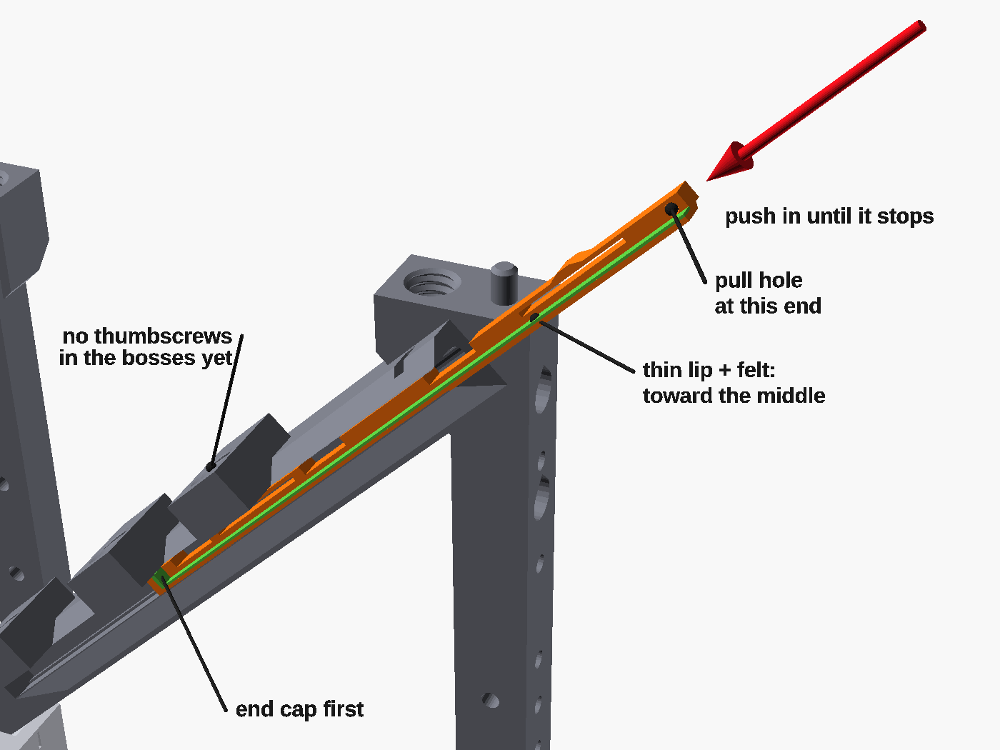

Before you start: the lid is off, and no glass thumbscrew is in its boss. If you left one in, back it off at least
three full turns.

1. Take the strip for one side. They are a mirror pair, so each one fits one side only.
2. Hold it end cap first, thin lip toward the middle of the rig, felt up.
3. Slide it into the channel from the open top-front end of the rib, under the bosses.
4. Push firmly until it stops against the closed lower-rear end. The spring bumps rub on the channel roof, so it takes
   a firm push.
5. Do the same on the other side.

> **Warning:** if a strip will not go the last few millimetres, don't hammer it. Pull it out (step 29) and look for a
> brim, a blob or a thumbscrew tip in the channel.

### Step 17. Check the strips

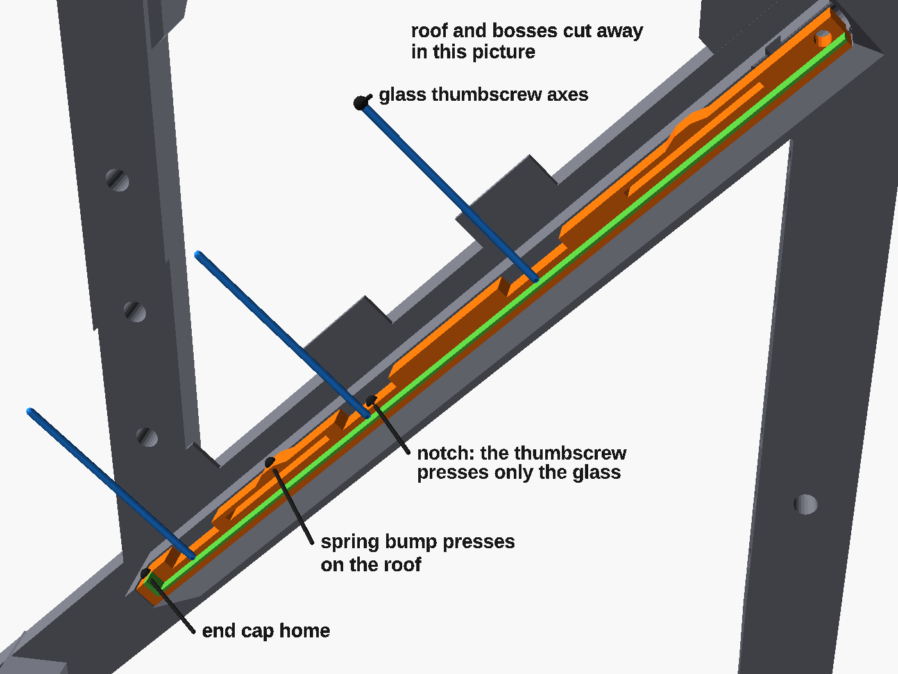

The roof of the channel is cut away in this picture so you can see the strip. Check each strip:

1. It is fully home: its end cap touches the closed lower-rear end of the channel.
2. It lies flat on its seat along its whole length, with no burr or rocking.
3. It stays in when you tilt the frame gently (there is no glass in yet). The spring bumps hold it.

When a strip is fully home, its three notches sit under the three thumbscrew holes, so the screws will press only on
the glass.

> **Tip:** if a strip is loose, the channel probably printed a little tall and the bumps no longer touch the roof.
> Put a strip of tape on the spring bumps and slide it in again.

The exact cross-section of the groove is in [img/groove_section.png](img/groove_section.png).

### Step 18. Felt on the channel roof

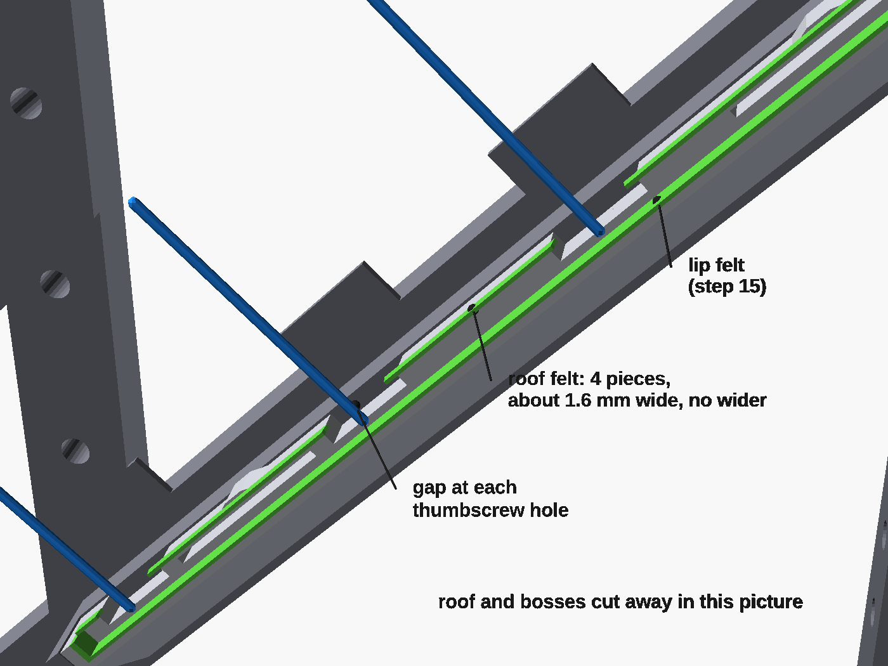

1. For each rib, cut a strip of 0.5 mm felt as wide as the channel roof above the glass edge and about 150 mm long.
   The roof is about 1.6 mm wide by default; the OpenSCAD console summary prints the exact width ("upper felt strip").
2. Cut it into four pieces, so the three thumbscrew holes stay uncovered.
3. Stick the pieces onto the roof from below, through the open groove, along its inner edge.

> **Warning:** keep the felt no wider than the roof. A wider strip hangs into the camera views.

A sharp knife and a steel ruler cut thin felt strips best. Add a second layer only if the glass still rattles after
step 20.

## 9. Glass

### Step 19. Slide the glass in, coated face down

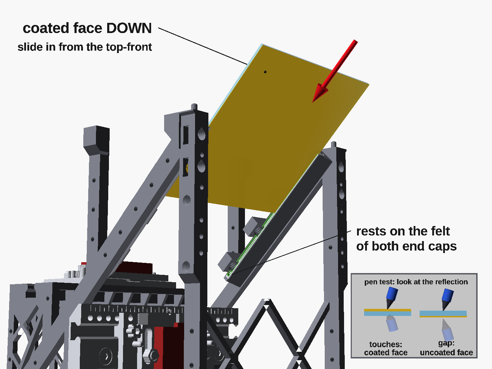

Wear gloves. The rig stands on the bench with the lid off.

1. Find the coated face. Touch a pen tip to the glass and look at its reflection (see the inset):
   - on the coated face, the bright reflection touches the tip;
   - on the uncoated face, it sits a small gap away.

   Many plates are also marked.
2. Hold the glass by its edges with the coated face **DOWN**, toward the bottom camera and the scene.
3. Slide it in diagonally from the top-front, along both grooves at once.
4. Stop when it rests on the felt of both end caps.

> **Warning:** coated face **down**. The other way round, the bottom camera's reflection would pass through the glass
> twice and show a ghost image. Never let bare plastic touch the coated face, and never force the glass past a tight
> spot.

### Step 20. Glass thumbscrews with felt tips

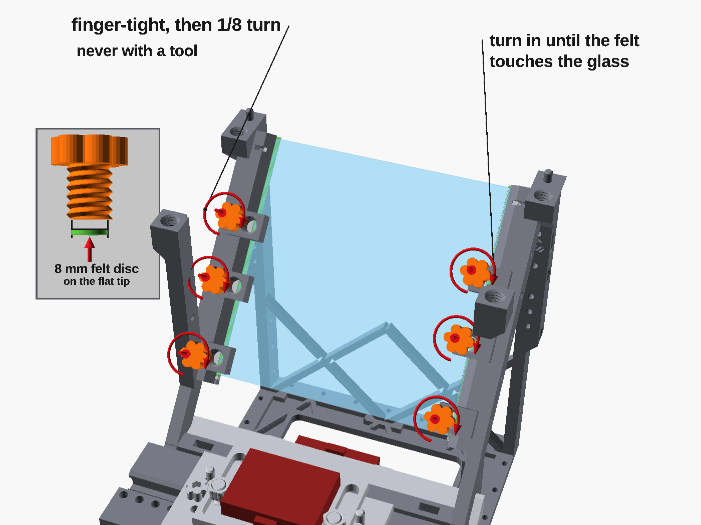

1. Punch six 8 mm felt discs. Use 8 mm, not 10 mm: the disc has to pass through the boss thread with the screw.
2. Stick one disc on the flat tip of each glass thumbscrew.
3. Turn the thumbscrews into the six bosses from above until each felt tip touches the glass.
4. Tighten all six evenly, a little at a time: finger-tight until the glass cannot rattle, then 1/8 turn more.

**Check:** tap the frame gently. The glass does not rattle.

> **Warning:** never use a tool on the glass thumbscrews. Too much force can crack the glass.

## 10. Close the top

### Step 21. Glass stops

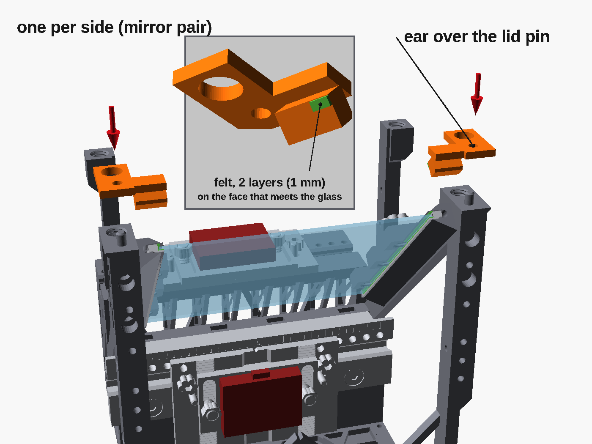

1. Stick two layers (1 mm) of felt on the face of each glass stop that meets the top edge of the glass (see the
   inset).
2. Lower each stop straight down onto the pin on its front post top, so its ear lies flat on the post top. They are a
   mirror pair, one per side.

The stops close the open top-front ends of the grooves. They keep the glass and the strips in.

> **Warning:** until the lid is on, the stops only rest on their pins. Don't move or tilt the rig now.

### Step 22. Fit the lid

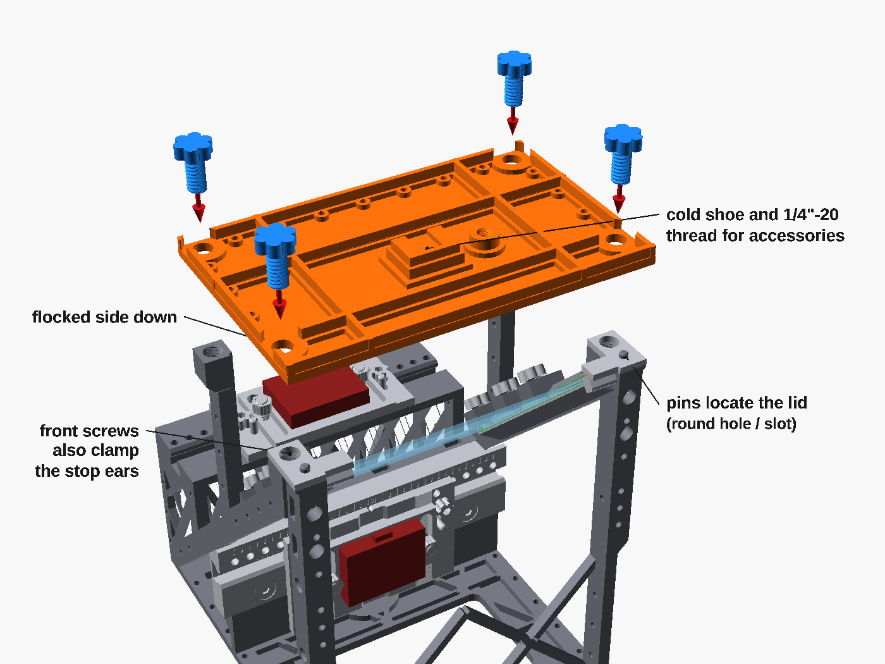

1. Lay the lid on the frame, flocked side down. The two pins on the front posts go into its two holes: the round one
   on one side, the slot on the other.
2. Turn the four M10 lid thumbscrews into the post-top pads, finger-tight. The front two also clamp the glass-stop
   ears.

**Check:** the lid sits flat on all four posts.

From now on the frame is fully stiff, and you can carry, tilt and mount the rig. The cold shoe and the 1/4"-20 thread
on top of the lid take light accessories.

## 11. Cameras

### Step 23. Prepare the cameras

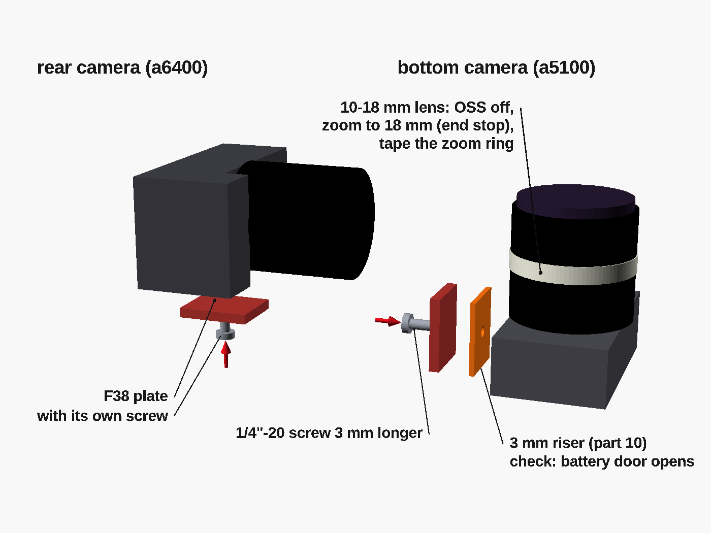

1. Screw an F38 plate under the rear camera (a6400) with the plate's own screw.
2. Put the 3 mm riser (`10_swap_shim_3mm_riser`) between the bottom camera (a5100) and its F38 plate. Fix them with
   the 1/4"-20 screw that is 3 mm longer than the plate's own.
3. Turn off lens stabilisation (OSS) on the 10–18 mm. Stabilisation moves the image and spoils the calibration.
4. Set the 10–18 mm to 18 mm, at its end stop, and tape the zoom ring there.

**Check:** the a5100's battery door still opens with the riser fitted.

The riser gives both bodies the same lens-axis height.

### Step 24. Click the cameras in

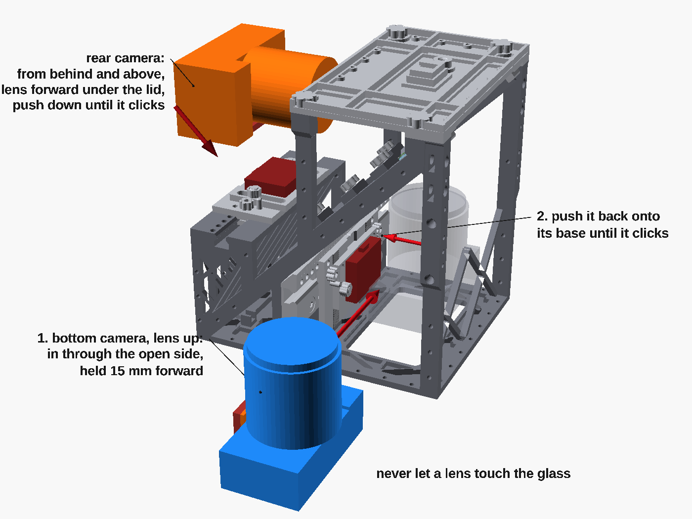

1. Rear camera: lower it onto its F38 base from behind and above, lens forward under the lid, until the plate clicks
   in.
2. Bottom camera: hold it lens up and pass it into the frame through an open side.
3. Keep it about 15 mm toward the front, so the lens and filter clear the diagonal rib.
4. Push it back onto its F38 base until it clicks.

The window in the base under the bottom camera shows its screen, and you can reach its buttons from below.

> **Warning:** never let a lens touch the glass.

## 12. First alignment

Do this once. Repeat it after changing the glass, a camera, a lens or a slide position. You need a laptop or any
image editor that can overlay two pictures (layers with transparency or "difference" mode).

### Step 25. Match the lens heights

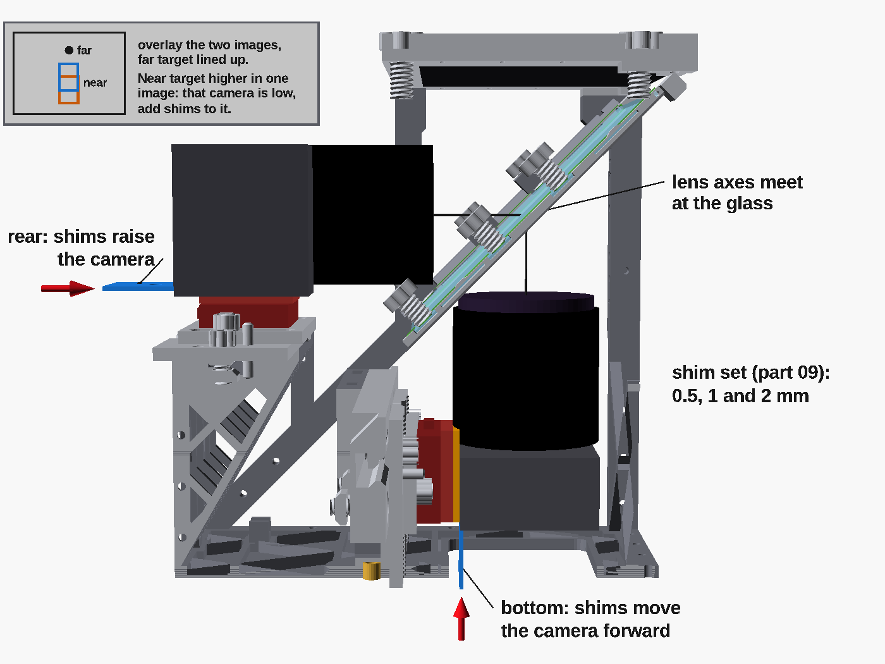

Each camera mount was made so that the camera can only sit slightly low (rear) or slightly too close to the crosswall
(bottom), never the other way. Shims correct this.

1. Set up a far target (20 m or more) and a near target (about 0.5 m) one behind the other, in the middle of the frame.
2. Take a picture with each camera. Flip the bottom camera's picture horizontally.
3. Overlay the two pictures so the far target matches.
4. If the near target then sits higher in one picture, that camera's viewpoint is low. Add shims (0.5, 1 or 2 mm,
   from `09_shim_set`) between that camera and its F38 plate.
5. Repeat until the near and far targets line up together.

Shims raise the rear camera and move the bottom camera forward.

### Step 26. Match the viewpoints and record

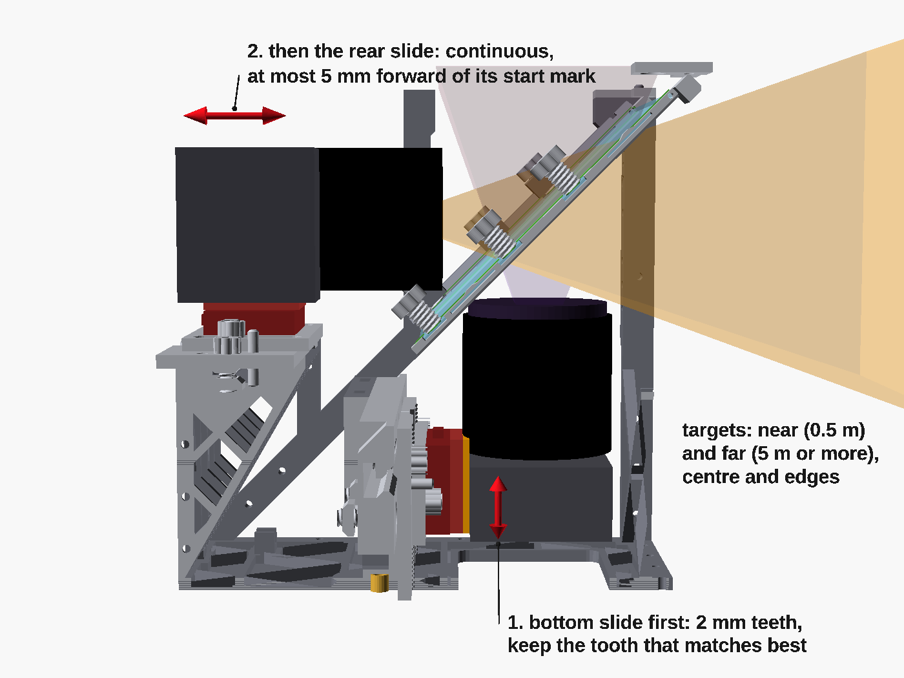

1. Set up near targets (about 0.5 m) and far targets (5 m or more), in the centre and toward the edges of the frame.
2. Set the bottom slide first. Loosen its thumb-nuts, try the neighbouring teeth (2 mm steps), and keep the tooth
   where the near and far targets match best.
3. Then move the rear slide, which is continuous, until the near and far targets line up the same way in both
   pictures. Never move it more than about 5 mm forward of its starting mark.
4. Tighten all thumb-nuts finger-tight. Write down both slide positions: count the teeth, and measure from the rear
   slide's edge to the carriage edge.
5. With everything locked, photograph a distant grid (20 m or more, or stars). Measure the remaining shift and
   rotation once, save it as a preset in your compositing software, and apply it to every shot.

The glass angle is fixed, so any small error is the same in every shot. That is why one preset removes it.

> **Warning:** align in the orientation you will shoot in. The bottom mount flexes slightly when the rig tilts.

## 13. Light-proofing

Both cameras also see, at 50 %, straight up through or off the glass. The flocked lid is the light trap for that
view, and the open sides must be closed for clean images.

### Step 27. Wrap the sides

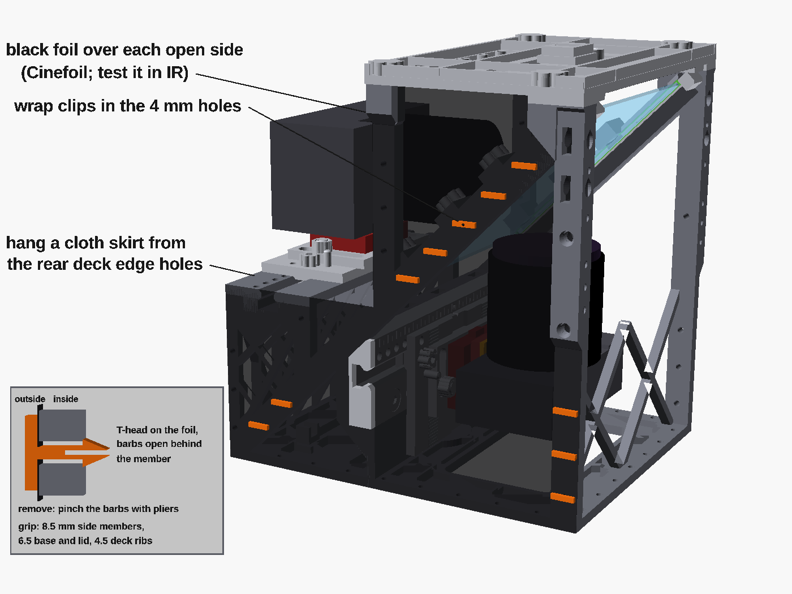

1. Cover both open sides with black aluminium foil (Cinefoil) or IR-tested blackout fabric.
2. Fix it with the printed wrap clips through the 4 mm holes along every frame member: 8.5 mm grip on the side
   members, 6.5 mm on the base and lid edges, 4.5 mm on the deck ribs.
3. Hang a cloth skirt from the holes along the rear deck edge.
4. Photograph a bright lamp through your wrap with the full-spectrum camera. If you can see the lamp, the material
   passes infrared: use another one.
5. In bright light, also tape a piece of the same foil over the window in the base. Peel it back when you need the
   bottom camera's screen.

To remove a clip, pinch its two barbs together with pliers.

Wrap for every compositing shot, and in stereo whenever light falls on the sides. The lid flocking and the paint were
done in step 4.

## 14. Stereo

### Step 28. Stereo

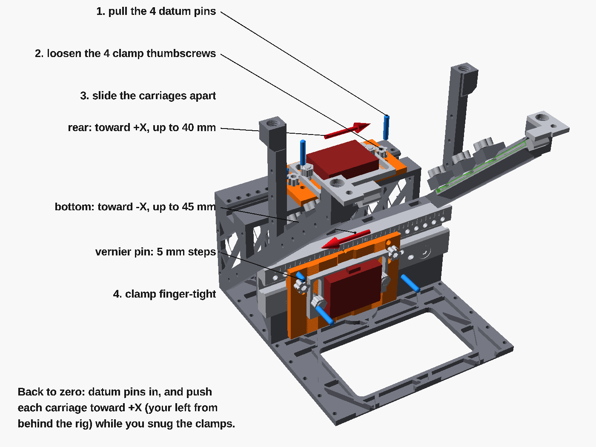

**Going to stereo:**

1. Pull the four datum pins and loosen the four carriage clamp thumbscrews.
2. Slide both carriages in opposite directions by half the interaxial you want: the rear one toward +X (your left from
   behind the rig, up to 40 mm), the bottom one toward −X (up to 45 mm).
3. For 5 mm steps, push a vernier pin through whichever vernier hole lines up with a rail hole.
4. Clamp finger-tight, and wrap the sides.

**Back to compositing:**

1. Slide both carriages back to zero and push the datum pins in.
2. While you snug the clamps, push each carriage lightly toward the +X side (your left, standing behind the rig facing
   the scene). Do it the same way every time.
3. Check the registration once. Printed pins repeat to about ±0.1 mm.

> **Warning:** never slide a carriage past its last index hole with a clamp loose, or the T-nut can leave the slot.

The bottom clamps can be reached from the front with a long key only at 0 and 35 mm. At other settings, reach in
from the sides. The clean crop you can expect at each stereo setting is in [DESIGN.md](DESIGN.md#stereo).

## 15. Service

### Step 29. Service: glass and strips

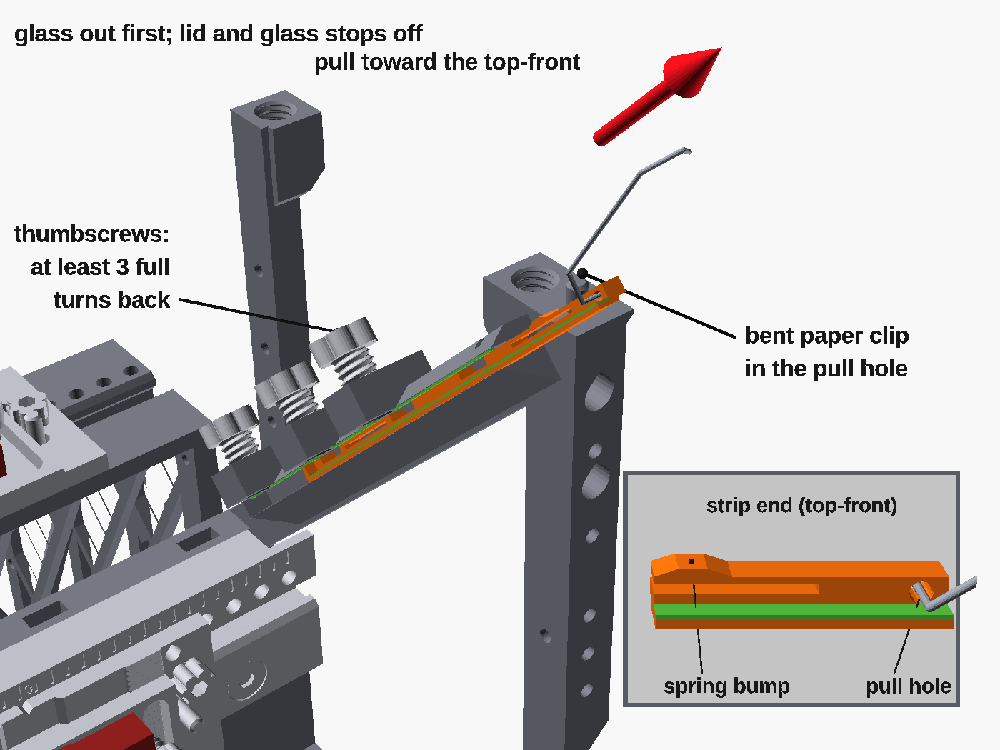

**Taking the glass out:**

1. Take the lid off (four thumbscrews). Keep the rig level on the bench.
2. Lift both glass stops off their pins.
3. Back off the six glass thumbscrews one full turn.
4. Wearing gloves, slide the glass out toward the top-front.

**Taking a strip out:**

1. Take the glass out first.
2. Back the glass thumbscrews off at least three full turns, so the spring bumps can pass under them.
3. Hook a bent paper clip into the pull hole at the strip's open end, and pull the strip out toward the top-front.

**Refitting:** follow steps 15–22. For glass of a different size, set `strip_glass` and reprint only
`08_groove_strips_x2.stl` (see [CUSTOMIZE.md](CUSTOMIZE.md#glass-size)). The frame stays the same.

**Storing:** lid on, glass in, rig upright. Re-snug the thumbscrews after a hot day, because PLA relaxes under load and
heat.

## 16. Using the rig

- **Stills:** a dual-release (Y-split) cable into both cameras' Multi terminals fires them together.
- **Video:** there is no hardware sync. Start both cameras, then clap or flash for a sync mark.
- **Lens aperture:** shoot the 15 mm at f/2.8 or slower. Wide open, its large pupil can just reach the groove lips at
  the extreme corners.
- **Accessories:** the lid has a cold shoe and a 1/4"-20 thread for a gyro logger or similar. The four horizontal
  printed 1/4"-20 threads on the front columns are for light accessories only. Clamp a carrying handle; don't hang the
  rig on one printed thread.
- **Gyro data:** the bottom camera sees the scene mirrored, so flip its footage horizontally before stabilising.
- **Before walking:** check that the glass thumbscrews and the lid thumbscrews are snug.

## 17. Troubleshooting

| Symptom | Likely cause | Fix |
|---|---|---|
| A printed screw binds or won't start | Thread printed tight, or a blob in it | Run the screw in and out a few times by hand. If it still binds, check `thread_test` and re-export with a larger `ps_clear` ([PRINTING.md](PRINTING.md#test-coupons) lists the parts). Never force it. |
| A pin won't slide through a carriage into the rail | Hole printed small | Check `pin_test` and re-export the parts with pin holes using a larger `pin_clr` ([PRINTING.md](PRINTING.md#test-coupons) lists them). |
| A groove strip won't go fully home | Brim or elephant's foot left on, a drooping boss corner, or a glass thumbscrew still in its boss | Pull the strip out (step 29), clean the strip and the channel (step 3), and back the thumbscrews off three turns. |
| A groove strip slides out by itself | Channel printed a little tall, so the spring bumps no longer touch the roof | Put a strip of tape on the spring bumps (step 17). |
| A strip rocks or doesn't lie flat | Burr on the strip's underside or on the seat, or felt under the strip | Deburr both faces. Felt goes only on the top of the lip and on the end cap. |
| The glass won't slide in | Felt wrinkled or too thick, roof felt too wide, or a thumbscrew still in | Back off the thumbscrews. Re-lay the felt flat. Trim the roof felt to the roof width. |
| The glass rattles | Thumbscrews not snug, or felt compressed | Tighten all six evenly to finger-tight plus 1/8 turn. If it still rattles, add a second layer of roof felt (step 18). |
| A glass thumbscrew tip doesn't seem to reach the glass | The felt disc is too big and tore or bunched up in the thread, or the strip is not fully home | Use 8 mm discs. Check that the strip is fully home so its notches sit under the screws (step 17). |
| A dark edge or a groove lip shows in the image corners | Roof felt too wide, lens wide open, or the lens pupils differ from the model's values | Trim the felt to the roof width. Stop the 15 mm down to f/2.8 or slower. Measure the entrance pupils ([CUSTOMIZE.md](CUSTOMIZE.md#finding-the-entrance-pupil-10-minute-method)). |
| Near and far objects don't line up between the cameras | Viewpoints not matched | Redo step 25 (lens heights) and then step 26 (slides). |
| The same small shift or rotation in every shot | The fixed glass angle is slightly off | Expected. Measure it once on a distant grid and apply it as a preset in post (step 26). |
| A faint second image (ghost) | Glass in upside down, or the plate's uncoated back face (a faint 2–4 % ghost is normal) | Check that the coated face is down (step 19). A plate with an anti-reflection coated back reduces the ghost. |
| Haze or flare, worst in the infrared camera | Light leaking in through the sides or lid holes, or black material that passes infrared | Wrap the sides, tape unused lid holes, and test the wrap with a lamp and the full-spectrum camera (step 27). |
| The bottom camera slips down | Teeth not meshed, or thumb-nuts loose | Re-seat the slide with its teeth fully in the carriage's teeth and tighten the thumb-nuts (step 14). |
| After stereo, the cameras no longer register | Carriage pushed to a different side of the pin play | Push each carriage toward +X while you snug the clamps, every time (step 28). |
| A T-nut came out of its slot | A carriage slid past its last index hole with a clamp loose | Take the carriage off, slide the T-nut back in from the end (bevels toward the opening) and refit (steps 10–11). |
| The bottom camera won't go in | Lens or filter catching on the diagonal rib | Pass it in lens up, about 15 mm toward the front, then push it back onto its base (step 24). |
| The lid won't sit flat | A glass stop is not down on its pin | Lift the lid, seat both stops flat on the post tops (step 21), refit the lid. |

Still stuck? See [LIMITATIONS.md](LIMITATIONS.md) for known open items, and please report what you find (see
[CONTRIBUTING.md](../CONTRIBUTING.md)).
