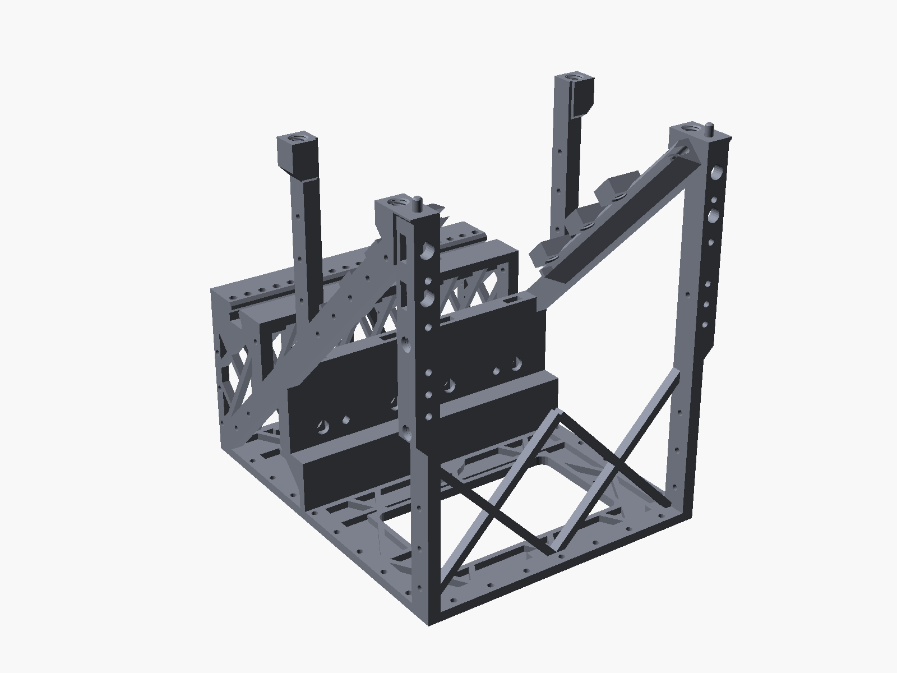

# Design notes

How the rig works, why it is shaped the way it is, and how the model checks itself. All dimensions are in mm, and all
values are for the default build. The OpenSCAD console prints the current values for your own settings.


## Coordinates

| Axis | Direction |
|---|---|
| X | left / right. The rig is mirror-symmetric about X = 0. |
| Y | front / back. The scene is at −Y. Y = 0 is the centre of the glass. |
| Z | up. Z = 0 is the underside of the base. The centre of the glass is at Z = `Zs` = 176. |

The glass lies in the plane z − 176 = −y: the front edge is high and the rear edge is low. For the glass grooves the
model also uses a plate-local frame: *x* = X, *v* = along the plate (positive toward the lower rear edge) and *w* =
plate normal toward the uncoated back.

## Optical layout

```
                     lid (light trap)
          ─────────────────────────────────
             ╲
   scene ◄─────╳◄────────────────  rear camera (visible): looks through the glass
               ▲ ╲
               │   ╲   glass at 45°, coated face down / front
               │
        bottom camera (infrared): looks up at the reflection
```

- **Glass:** a 150 × 150 × 2 mm plate beam splitter (50 % reflection, 50 % transmission) at exactly 45°. Its coated
  face points toward the scene and the bottom camera. The clear aperture is 146 × 146 mm, because each edge sits 2 mm
  deep in its groove.
- **Rear camera** (default a6400 + 15 mm F1.4) sees the scene through the glass. The 2 mm glass shifts its image
  sideways by about 0.67 mm. The shift is constant and can be ignored.
- **Bottom camera** (default full-spectrum a5100 + 10–18 mm at 18 mm with a 62 mm IR filter) sees the scene reflected
  by the coated face. Its image is mirrored.
- **Lid views:** each camera also sees, at about 50 %, straight up from the glass. The rear camera sees it by
  reflection and the bottom camera by transmission. The lid is therefore a closed light trap with a flocked underside,
  and the sides must be wrapped.
- **Ghost:** an uncoated back face reflects 2–4 %. A plate with an anti-reflection coated back is better.

## Shared viewpoint

For the two images to line up at every distance, both entrance pupils must sit at the same optical distance **D**
from the glass, on the same (folded) axis:

D = g<sub>rear</sub> + ep<sub>rear</sub> = g<sub>bottom</sub> + ep<sub>bottom</sub> ≈ 69.5 mm

*g* is the distance from the glass centre to the front of each lens, and *ep* is how far the entrance pupil sits behind
that front. Each *g* has a minimum:

- **Glass clearance:** at least 3 mm between lens and glass, measured normal to the plate.
- **Mutual visibility:** each lens rim must stay at least 3 mm outside the *other* camera's view. The bottom lens's
  filter ring sticks out 6 mm, so it is the binding rim. It puts the bottom lens front 44.5 mm from the glass centre.

The difference between the two pupils is taken up by the slides. The rear slide has 40 mm of continuous travel along Y.
The bottom slide has 20 mm along Z, in 2 mm serrated steps, so the camera weight sits on teeth rather than friction.
Set the bottom slide to the nearest tooth first, then the rear slide, and the residual mismatch is zero.

## Why the common frame is 19 mm

The "clean" frame is the field of view in which neither camera sees the other lens, the groove lips or any part of the
frame. A wider view needs the lenses further from the glass (mutual visibility). But the further away they are, the
wider their cones are at the glass, and the 146 mm clear aperture runs out:

| Target frame (APS-C, 16:9) | Common pupil distance D | Clear glass width needed (146 available) |
|---|---|---|
| 18 mm, with the 62 mm IR filter | 72.6 | 150. Fails: the groove lips are in view. |
| **19 mm, with the filter (default)** | **69.5** | **132** |
| 20 mm, with the filter | 67.7 | 119 |
| 18 mm, no filter | 66.5 | 137 |

So the 10–18 mm is used at its 18 mm stop and cropped by about 5 % to the 19 mm frame, and the 15 mm on the rear
camera is cropped to about 79 % to match. 19 mm is the shortest focal length, in 0.5 mm steps, that passes with the
default filter.

At 19 mm, the margins (how far each part stays outside both views, for a pinhole pupil) are:

| Feature | Margin |
|---|---|
| Lower groove lip (coated side) | 2.6 |
| Upper groove flank | 2.0 |
| Thumbscrew heads | 4.5 |
| Thumbscrew bosses | 5.5 |
| Glass stops | 5.4 |
| Side truss members | 6.0 |

The model asserts at least 0.5 mm for each. A real lens has a pupil of finite size: wide open at f/1.4, it uses up about
1.6 mm of these margins at the extreme corner. That is why the 15 mm should be shot at f/2.8 or slower.

The lip shape follows the same logic. The lower lip stands at most 1.5 mm proud of the coated face for 1.5 mm, then
bevels away at 1 : 1.6, which is steeper than the grazing rays (about 65° incidence at the far corner).

## Stereo

Both carriages slide in opposite directions: the rear one up to 40 mm, the bottom one up to 45 mm, for a maximum split
of 85 mm. Moving both, instead of only one camera twice as far, halves the clipping in each image. Index holes give 5
mm steps, and datum pins return both carriages to zero.

As the cameras move off-centre, the **front posts** and the **top corners of the glass** start to cut into each image.
The table below gives the largest centred crop (same aspect) that is clean in **both** images:

| Split interaxial (rear + / bottom −) | Clean crop, wrapped sides | Clean crop, open sides |
|---|---|---|
| 0 | 100 % | 100 % |
| 10 (+5 / −5) | 98 % | 98 % |
| 20 (+10 / −10) | 93 % | 91 % |
| 30 (+15 / −15) | 86 % | 82 % |
| 40 (+20 / −20) | 80 % | 75 % |
| 50 (+25 / −25) | 74 % | 66 % |
| 60 (+30 / −30) | 68 % | 58 % |
| 70 (+35 / −35) | 61 % | 50 % |
| 80 (+40 / −40) | 53 % | 42 % |
| 85 (+40 / −45, maximum) | 50 % | 33 % |

"Wrapped" means the sides are covered. With open sides, the lid views also see thumbscrews, bosses and the outside
world through the open truss, which shrinks the clean crop further.

> **This table is a sampled estimate, not a measurement.** It traces rays from a point-sized (pinhole) pupil on a
> 256 × 144 grid (one column = 0.8 % of the width) through a simplified model of the obstacles. A real lens has a
> finite aperture (soft edges), distortion and focus breathing. The groove strips can also shift about 0.3 mm. The
> coarser estimate in the OpenSCAD console (64 × 36 rays) can miss thin edge losses: at a 10 mm split it reports 100 %.
> Check your actual crop on real images. To reproduce the table, run `python3 tools/stereo_clip.py --grid 256x144`
> (about 2 minutes).

## Glass holder

- **Angle from the frame.** Each diagonal rib of the frame has a channel with a flat **seat face** printed at the
  glass angle. A printed **groove strip** lies flat on that seat. The strip carries the lower lip (the felt-covered face
  the glass rests on), a spine that fills the channel up to 0.5 mm below its roof, and the lower-rear end cap. A strip
  of even thickness cannot tilt the glass, so the frame alone sets the angle.
- **Sprung.** Two printed leaf springs in each spine carry a bump that stands 0.35 mm proud of the channel roof. They
  press the strip onto the seat (about 2.6 N each), so it stays in with or without the glass, and the spine cannot lift
  over the key ridge. The leaf works at about 17 MPa, and at about 27 MPa if the printed roof sits 0.3 mm low.
- **Clear of the thumbscrews.** Under each thumbscrew the spine drops to 1 mm below the glass top, so the screw tips
  can only touch the glass.
- **Keyed.** A 1.4 mm ridge on the seat sits under a step in each strip and stops it moving outboard (0.3 mm play). A
  step instead of a closed slot accepts a ridge that printed a little fat. The springs' friction and the glass edge
  hold the strip inboard. Print both strips together so their lips have the same thickness: 0.1 mm of difference rolls
  the glass about 0.04°.
- **Held, not clamped hard.** Gravity sets the glass on the lower lip and the lower-rear end cap. Three felt-tipped M10
  thumbscrews per side press it gently onto that reference from above. They sit at 18 mm toward the front, and 20 mm
  and 65 mm toward the rear, along the plate from its centre, placed outside every view and clear of the rear lens in
  stereo.
- **Stops.** The groove is open at the top-front for insertion. Two glass stops close it. They hang on the lid pins and
  are clamped by the front lid thumbscrews.
- **Swappable.** Different glass, or a damaged groove, means new strips (`strip_glass`), not a new frame.
- **No adjuster.** There is deliberately no angle adjustment, in favour of rigidity and simplicity. A 0.2° error in the
  printed angle tilts the reflected view by 0.4°. That offset is the same in every shot, so it is measured once and
  removed in post.
- **Insertion path.** The `insert_check` and `strip_insert_check` parts sweep the glass and strip along their path and
  intersect them with everything else. The result is empty, so the glass slides in with the cameras mounted, at stereo
  0 and at the extremes.

## Structure



- **One-piece open-truss frame**, 208 × 235 × 244 mm, printed standing on its base:
  - **glass rib** tapers into the side-plane diagonal through a gusset at its lower-rear end, so the section does not
    step down where the rib meets the rear post.
  - **base** (6 mm, pocketed): the bottom chord, with a window (126 × 72 mm, rounded corners) under the bottom
    camera's screen and buttons. The pocketing already thins the base to a 2 mm skin there, so the window costs little
    stiffness: its full-depth rim, the crosswall and the front X-brace carry the loads (`lcd_window = false` keeps the
    skin)
  - **two side trusses** of 8 mm members, each made of a front post, the diagonal glass rib (the main member), a rear
    post, a deck strut and a deck side rib, all arranged in triangles
  - **front X-brace** (below the view) and a **rear W-truss** (under the deck), which stop the open frame from racking
    sideways
  - **crosswall**: a pocketed shear wall behind the bottom camera, with two stiffening ribs, carrying the wall rail
  - **rear deck** at Z = 112 with an integral T-slot rail for the rear camera
- **Lid:** the top chord. Four M10 thumbscrews go into threaded pads on the post tops, and two pins on the front posts
  locate it. The frame is only fully stiff with the lid on.
- **Wall rail:** the bottom camera's rail is a separate bar printed flat. A T-slot cut into the standing wall would have
  started in mid-air. Four M8 bolts and T-nuts fix it to the crosswall, and two pins locate it.
- **Rails and carriages:** the T-slots have 45° roofs, and the printed T-nuts have matching 45° bevels that bear flat on
  them. Carriages and slides run on 45° trapezoid tongues with 0.2 mm clearance. Each carriage has a datum pin pair
  (90 mm apart) and vernier holes for 5 mm steps.
- **F38 slides:** 6 mm plates. The 1/4" screw head that holds the F38 base is hidden inside the guide tongue.
- **Tripod socket:** under the crosswall foot, about 15 mm behind the loaded centre of gravity. The base is solid in a
  Ø46 mm circle around it, so the tripod plate bears on stiff material on both sides.
- **Loaded mass:** about 2.4 kg (PLA, both cameras, glass), with the centre of gravity about 116 mm above the base.

## Printed hardware

| | |
|---|---|
| Thread form | single start, 45° flanks, flats 0.1 × pitch, depth 0.4 × pitch, built as one helical polyhedron (64 facets per turn) |
| Standards | M10 × 2 (lid, glass, Arca plate) and M8 × 2 (where a Ø20 head does not fit: carriage and slide clamps, rail bolts) |
| Clearance | `ps_clear` = 0.2 mm radial, which leaves 0.6 mm of engagement |
| 1/4"-20 female (for steel screws) | asymmetric: the downward-facing flanks are 45° (printable), and the loaded flanks are at the standard 30° |
| Strength (PLA, across layers) | M10 ≈ 1 kN, M8 ≈ 0.6–0.9 kN. Working loads are under 30 N, and a finger-tight thumbscrew preloads about 100–200 N. |

Screws print standing head-down and nuts print flat, both at 100 % infill.

**Thread handedness:** the frame's −X half is a mirror image of the +X half, and mirroring a thread makes it
left-handed. The model undoes the mirror locally for every printed female thread, so all threads are right-handed.

## Printability rules

- Every downward-facing surface is at 45° or steeper. Horizontal holes are teardrops.
- No part has a layer that starts in mid-air. Bridges are at most about 19 mm.
- Every part fits 250 × 250 × 245 mm, and the model asserts this.
- Every part is exported lying in its print orientation, so no supports are needed.
- Two known exceptions: the cantilevered corners of the glass-thumbscrew bosses, and the 45°-tilted threads in those
  bosses (see [PRINTING.md](PRINTING.md#slicer-warnings-you-can-ignore)).

## Verification

| Check | How to run | What "good" looks like |
|---|---|---|
| Assertions and summary | `openscad -o out/summary.echo -D 'part="none"' model/beamsplitter_rig.scad` | No `ERROR: Assertion` line. Read the summary at the top. |
| Glass and strip insertion | Render `part="insert_check"` and `part="strip_insert_check"` (F6, several minutes) | Empty result |
| Mid-air starts | `python3 tools/islands.py part.stl 0.2 0.25 1` (STL in print orientation, as exported) | the `floating island starts` count is 0 |
| Bridge spans | `python3 tools/bridges.py part.stl` | max bridge ≤ about 19 mm, 0 islands |
| Overhangs | `python3 tools/overhang_scan.py part.stl` | Only the known regions (rear-deck bridges, boss corners, tilted threads) |
| Stereo crop | `python3 tools/stereo_clip.py --grid 256x144` (optional `--point 20,20`, `--ep15`, `--ep1018`, `--f`) | The table above |
| Centre of gravity | see the usage notes at the top of `tools/cog.py` (needs `part="world"` exports) | Tripod socket close to the CoG |

`islands.py`, `bridges.py` and `overhang_scan.py` need Python 3 with numpy. `stereo_clip.py` and `cog.py` need only the standard library.
`stereo_clip.py` rebuilds the geometry independently from the same parameter values, so it is a cross-check of the
OpenSCAD estimate. Pass the same values to both if you change the optics.
